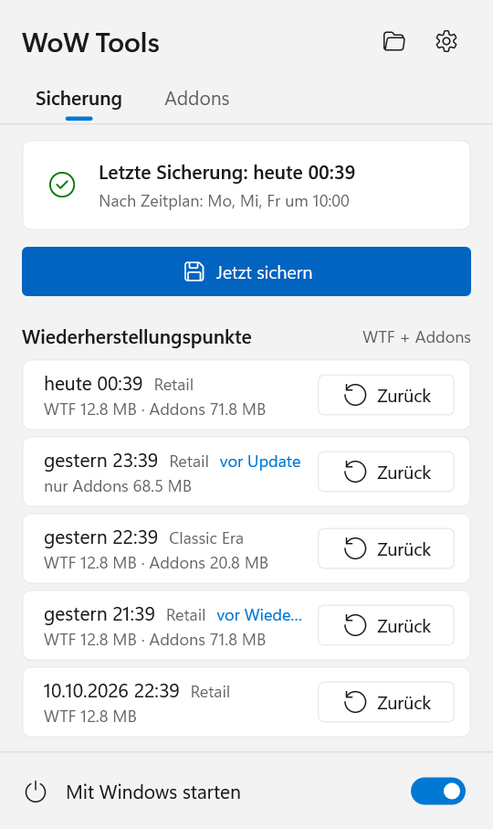
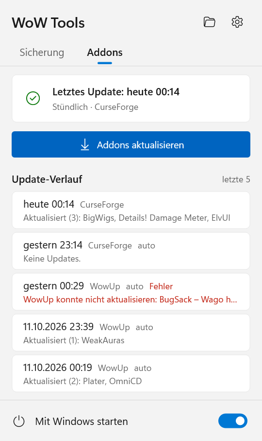
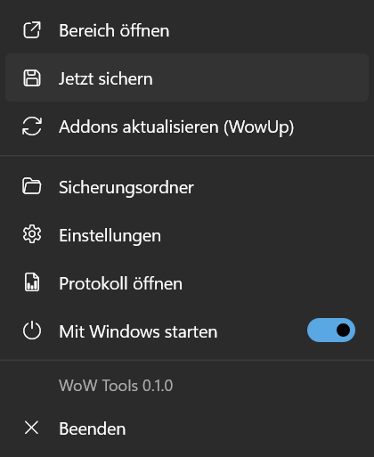
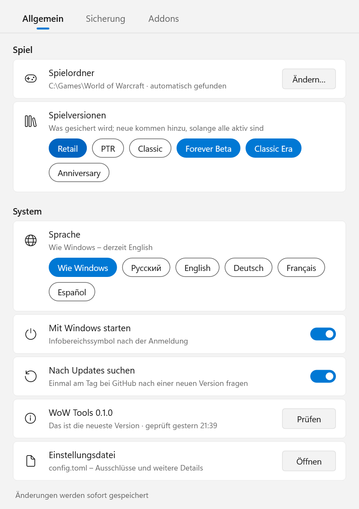
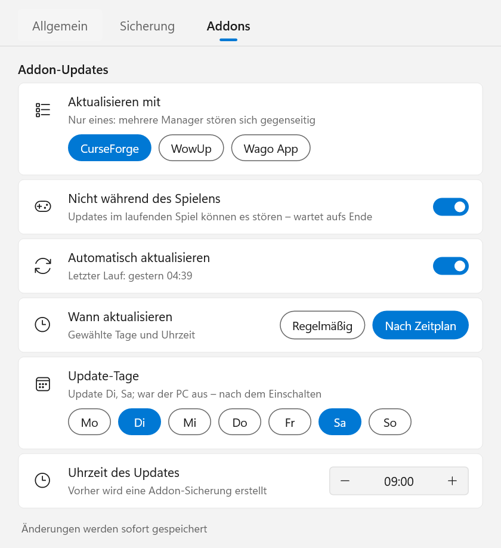

# WoW Tools

[English](README.md) · [Русский](README.ru.md) · **Deutsch** · [Français](README.fr.md) · [Español](README.es.md)

Ein kleines Windows-Programm für den Infobereich (Tray), das Ihre Einstellungen und Addons in World of Warcraft schützt:

- **Sicherungen** von `WTF` (Tastenbelegung, Makros, Chat, CVars, Addon-Einstellungen) und `Interface\AddOns` – nach
  jeder Spielsitzung oder nach Zeitplan, für jede installierte Spielversion.
- **Wiederherstellen mit einem Klick** auf jeden früheren Stand; der aktuelle Stand wird vorher gesichert, sodass sich
  jede Wiederherstellung rückgängig machen lässt.
- **Einstellungen zwischen Charakteren kopieren**: Tastenbelegung, Makros, Chatfenster, Fensteranordnung, aktivierte
  Addons, Addon-Einstellungen.
- **Addon-Updates** über den Addon-Manager, den Sie ohnehin nutzen – CurseForge, WowUp, WowUp-CF oder die Wago App –
  ohne Fenster gestartet, nach Zeitplan und nie, während Sie spielen.
- Aktualisiert sich selbst: fragt einmal am Tag bei GitHub nach und installiert eine neue Version mit einem Klick.
- Englisch, Russisch, Deutsch, Französisch und Spanisch.

<p>
  
  
  
</p>

## Inhalt

- [Voraussetzungen](#voraussetzungen)
- [Installation](#installation)
- [Das Infobereichssymbol und der Bereich](#das-infobereichssymbol-und-der-bereich)
- [Einstellungen](#einstellungen)
- [Sicherungen: so funktionieren sie](#sicherungen-so-funktionieren-sie)
- [Wiederherstellen](#wiederherstellen)
- [Addon-Updates](#addon-updates)
- [Einstellungen zwischen Charakteren kopieren](#einstellungen-zwischen-charakteren-kopieren)
- [Befehlszeile](#befehlszeile)
- [Dateien und Ordner](#dateien-und-ordner)
- [Datenschutz und Sicherheit](#datenschutz-und-sicherheit)
- [WoW Tools aktualisieren](#wow-tools-aktualisieren)
- [Deinstallation](#deinstallation)
- [FAQ und Einschränkungen](#faq-und-einschränkungen)
- [Aus dem Quellcode bauen](#aus-dem-quellcode-bauen)

## Voraussetzungen

- **Windows 10 oder 11**, 64 Bit. Sonst muss nichts installiert werden: Es ist eine einzelne `.exe` ohne
  Laufzeitabhängigkeiten.
- **World of Warcraft**, installiert über Battle.net. Jede Spielversion wird unterstützt: Retail, Classic (Progression),
  Classic Era / Hardcore / Season of Discovery, Anniversary, PTR, Beta und auch Versionen, die es noch gar nicht gibt –
  alles in einem `_name_`-Ordner neben `_retail_`.
- Nur für Addon-Updates – **eines** dieser Programme, installiert und eingerichtet (angemeldet, Spielordner gewählt):
  - die [CurseForge](https://www.curseforge.com/download/app)-App;
  - [WowUp](https://wowup.io/) oder WowUp-CF (die Variante mit CurseForge-Unterstützung);
  - [Wago App](https://addons.wago.io/app) – nur für WeakAuras und UI-Pakete, siehe [unten](#wago-app).

  Sicherungen, Wiederherstellung und das Kopieren zwischen Charakteren funktionieren auch ohne sie.

## Installation

1. Laden Sie `WoW-Tools-x.y.z.exe` unter [Releases](https://github.com/Gronck2/wow-tools/releases) herunter.
2. Legen Sie die Datei in einen festen Ordner (zum Beispiel `%LOCALAPPDATA%\Programs\WoW Tools\`) – der Autostart
   merkt sich diesen Pfad.
3. Starten Sie sie. Ein Symbol erscheint im Infobereich; der Spielordner wird automatisch gefunden (Registry,
   Battle.net, übliche Pfade).

Windows SmartScreen warnt eventuell vor einem unbekannten Herausgeber, da die exe nicht signiert ist: Wählen Sie
**Weitere Informationen → Trotzdem ausführen**. Zu jedem Release wird die SHA-256-Prüfsumme der Datei angegeben, damit
Sie den Download prüfen können (`Get-FileHash .\WoW-Tools-0.1.0.exe`).

Wird die exe erneut gestartet, während sie bereits läuft, öffnet sich das Einstellungsfenster.

## Das Infobereichssymbol und der Bereich

Das Symbol zeigt den aktuellen Zustand:

| Symbol | Bedeutung |
| --- | --- |
| grün | alles in Ordnung |
| Ring | das Spiel läuft, die Sicherung folgt nach dem Beenden |
| blau | in Arbeit: Sicherung, Wiederherstellung oder Addon-Update |
| rot | der letzte Vorgang ist fehlgeschlagen (Mauszeiger auf das Symbol halten oder den Bereich öffnen, um den Grund zu sehen) |
| grau | noch keine Sicherungen |

**Linksklick** öffnet den Bereich (im Stil von Windows 11, folgt dem hellen/dunklen Design und der Akzentfarbe):

- Reiter **Sicherung**: wann die letzte Sicherung erstellt wurde und wann gesichert wird, **Jetzt sichern** und die
  neuesten Wiederherstellungspunkte jeder Spielversion mit der Schaltfläche **Zurück** (bestätigt wird direkt in der
  Zeile mit **Wiederherstellen**).
- Reiter **Addons**: wann die Addons zuletzt aktualisiert wurden, **Addons aktualisieren** und die letzten fünf
  Update-Läufe – was aktualisiert wurde oder was schiefging (für den vollständigen Text den Mauszeiger auf die Zeile
  halten).
- Oben: der Sicherungsordner und die Einstellungen; unten: **Mit Windows starten**.

**Rechtsklick** öffnet das Menü: Bereich, jetzt sichern, Addons aktualisieren, Sicherungsordner, Einstellungen,
Protokoll, Autostart, Beenden.

Benachrichtigungen erscheinen für die Ergebnisse dessen, was Sie selbst gestartet haben, und bei neuen Fehlern.

## Einstellungen

<p>
  
  
</p>

Jede Änderung wird sofort gespeichert und ohne Neustart übernommen.

- **Allgemein**: Spielordner (automatisch gefunden, auch manuell festlegbar), welche Spielversionen gesichert werden,
  Sprache, Start mit Windows, **Nach Updates suchen** und die aktuelle Version mit **Prüfen** / **Installieren** sowie
  ein Link zu `config.toml` für selten benötigte Optionen.
- **Sicherung**: wann gesichert wird (*Nach dem Spiel*, also beim Beenden, oder *Nach Zeitplan* – an gewählten
  Wochentagen zu einer festen Uhrzeit), wie viele Sicherungen behalten werden, die Schalter **Addons sichern** und
  **Auf Spielende warten**, der Sicherungsordner.
- **Addons**: das Programm für die Updates, **Nicht während des Spielens**, **Automatisch aktualisieren** und wann –
  *Regelmäßig* (alle 30 Min. … 12 Std.) oder *Nach Zeitplan* (Tage und Uhrzeit).

## Sicherungen: so funktionieren sie

- Eine **Sicherung** ist ein Zip-Archiv eines Ordners: `WTF` und `Interface\AddOns` werden getrennt archiviert, und
  zwar für jede Spielversion einzeln. Die Pfade im Archiv sind relativ zum Ordner der Spielversion.
- Gesichert wird **nur, wenn sich etwas geändert hat**: WoW Tools merkt sich einen Fingerabdruck des Ordners
  (Dateipfade, Größen, Änderungszeiten) und überspringt unveränderte Ordner. Addons, die sich selten ändern, kosten
  daher fast nichts.
- **Solange eine Spielversion läuft, werden ihre Sicherungen übersprungen**: WoW schreibt `WTF` und
  Addon-Einstellungen beim Ausloggen oder Beenden, eine Kopie während des Spielens wäre also halb veraltet. Andere
  Versionen werden wie gewohnt gesichert. Im Modus *Nach dem Spiel* wird die Sicherung wenige Sekunden nach dem
  Schließen des Clients erstellt.
- **Nach Zeitplan**: War der PC zur geplanten Zeit aus, wird nach dem Einschalten gesichert; lief das Spiel, direkt
  nach dem Beenden. Eine manuelle Sicherung zählt als geplante.
- **Aufbewahrung**: Die neuesten `keep` Sicherungen (standardmäßig 30) jeder Reihe bleiben erhalten, ältere werden
  gelöscht.
- `*.bak`- und `*.old`-Dateien werden ausgelassen (deshalb passt ein 155 MB großer `WTF`-Ordner meist in ~13 MB). Die
  Liste steht als `exclude_ext` in `config.toml`.

## Wiederherstellen

**Zurück** im Bereich setzt `WTF` und Addons dieser Spielversion auf den damaligen Stand zurück. Die Spielversion muss
geschlossen sein (andere dürfen laufen). Bevor etwas ersetzt wird, wird der aktuelle Stand als Sicherung mit der
Bezeichnung *vor Wiederherstellung* gespeichert – Sie können also jederzeit zurück.

Die Wiederherstellung entpackt das Archiv in einen temporären Ordner neben dem echten und tauscht erst dann die Ordner
aus. Eine unterbrochene Wiederherstellung hinterlässt daher nie ein halb geschriebenes `WTF`.

Punkte mit der Bezeichnung *vor Update* enthalten nur Addons – sie machen ein Addon-Update rückgängig und lassen die
Einstellungen unverändert.

Über die Befehlszeile: `wow-tools restore` (neueste), `wow-tools restore 20261012` (die neueste dieses Tages oder
davor), `--kind wtf` oder `--kind addons` für nur einen Teil, `--flavor _classic_era_` für eine andere Spielversion.

## Addon-Updates

WoW Tools lädt selbst keine Addons herunter. Es startet den Addon-Manager, den Sie bereits haben, lässt ihn sein
übliches Update durchführen und schließt ihn wieder. So bleiben die Daten des Managers korrekt, und Autoren, die
Downloads nur über offizielle Clients erlauben, werden respektiert.

Es wird nur **ein** Programm verwendet: Zwei Manager, die am selben `AddOns`-Ordner arbeiten, überschreiben sich
gegenseitig die Dateien. Haben Sie mehrere, wählen Sie eines unter **Einstellungen → Addons**; ist nur eines
vorhanden, wird es automatisch verwendet.

Bei jedem Lauf, automatisch oder manuell:

1. Ist **Nicht während des Spielens** an (Standard), passiert nichts, solange ein Spielclient läuft; das Update wartet,
   bis das Spiel geschlossen ist.
2. Eine `AddOns`-Sicherung mit der Bezeichnung *vor Update* wird erstellt – ein Klick im Bereich macht das Update
   rückgängig.
3. Das Programm wird ohne Fenster gestartet, aktualisiert und wird geschlossen. **Ein Programm, das Sie bereits
   geöffnet hatten, bleibt unangetastet** – es wird weder ein zweites Mal gestartet noch geschlossen.
4. Das Ergebnis landet im Update-Verlauf: welche Addons aktualisiert wurden, welche noch warten (zum Beispiel weil sie
   im Programm auf manuelle Updates gestellt sind) oder warum es fehlgeschlagen ist.

Ist das automatische Aktualisieren im Programm aus, wird es nur für diesen Lauf eingeschaltet und danach wieder
ausgeschaltet (auch wenn der Lauf abgebrochen wurde – das wird beim nächsten Mal nachgeholt). Addons, die Sie im
Programm auf manuell gestellt oder ignoriert haben, werden nicht angefasst.

### CurseForge

Wird mit `--minimized` gestartet (in seinen Infobereich, wie bei seinem eigenen Autostart). WoW Tools verfolgt sein
Protokoll, bis die Update-Prüfung abgeschlossen ist und eine Minute lang nichts installiert wurde (höchstens
10 Minuten), und schließt es dann.

### WowUp und WowUp-CF

Wird mit `--hidden --quit` gestartet: eine stille Auto-Update-Runde, danach beendet es sich selbst. WowUp aktualisiert
nur Addons mit aktiviertem Auto-Update; WoW Tools aktiviert es für diesen Lauf bei jedem Addon, das nicht ignoriert
wird.

> **Addons von Wago über WowUp.** Das normale WowUp erhält seine Download-Berechtigung für Wago über die Werbung in
> seinem Fenster. Ohne Fenster gestartet, bekommt es keine, und Wago verweigert den Download. Solche Addons stehen mit
> diesem Grund im Verlauf. Aktualisieren Sie sie, indem Sie WowUp öffnen, hinterlegen Sie einen Wago-Schlüssel in den
> Einstellungen von WowUp, oder nutzen Sie CurseForge / WowUp-CF, wenn die meisten Ihrer Addons von dort stammen.

### Wago App

Die Wago App kann Addons nicht unbeaufsichtigt aktualisieren – nur über ihre Schaltfläche *Update All* –, daher
aktualisiert sie als gewähltes Programm **nur WeakAuras und UI-Pakete**. Ist sie gewählt, erscheinen zwei Schalter:
**WeakAuras** und **UI-Pakete**. Die App wird minimiert gestartet, schreibt ihre Updates nach
`AddOns\WagoAppCompanion` (WeakAuras, werden im Spiel übernommen) und `AddOns\WagoUI_Storage` (UI-Pakete) und wird
geschlossen, sobald sie 15 Sekunden lang nichts mehr getan hat. Ein Teil, den Sie ausgeschaltet haben, bleibt genau
so, wie er war. Sind beide aus, gibt es nichts zu tun, und die App wird nicht gestartet.

## Einstellungen zwischen Charakteren kopieren

Charaktere liegen unter `WTF\Account\<ACCOUNT>\<Realm>\<Name>`. So kopieren Sie die Einrichtung eines Charakters auf
andere:

```
wow-tools chars
wow-tools copy-char --from "Tarren Mill/Groncky" --to "Kazzak/Groncky" --dry-run
wow-tools copy-char --from "Tarren Mill/Groncky" --to "Kazzak/Groncky" --to "Silvermoon/Gronckowski" --parts bindings,macros,savedvars
```

| Teil | Was | Datei |
| --- | --- | --- |
| `bindings` | Tastenbelegung | `bindings-cache.wtf` |
| `macros` | Charaktermakros | `macros-cache.txt` |
| `chat` | Chatfenster und Kanäle | `chat-cache.txt` |
| `config` | Charakter-CVars | `config-cache.wtf` |
| `layout` | Fensterpositionen | `layout-local.txt` |
| `addons` | welche Addons aktiviert sind | `AddOns.txt` |
| `savedvars` | Addon-Einstellungen des Charakters | `SavedVariables\*.lua` |

Ohne `--parts` wird alles kopiert. Bei Namen spielt Groß-/Kleinschreibung keine Rolle (auch bei kyrillischen); gibt es
einen Namen auf mehreren Accounts, schreiben Sie `ACCOUNT/Realm/Name`. `WTF` wird vorher als Sicherung *vor Kopieren*
gespeichert, und die Spielversion muss geschlossen sein.

Tastenbelegung und Makros können auf den Servern von Blizzard gespeichert sein (CVars `synchronizeBindings` /
`synchronizeMacros`); dann kann die Serverkopie die kopierten Dateien beim Einloggen überschreiben.

## Befehlszeile

`wow-tools` ohne Befehl startet das Infobereichssymbol. Alles andere ist auch über die Konsole verfügbar:

| Befehl | Funktion |
| --- | --- |
| `init [--wow-path DIR] [--backup-dir DIR]` | Konfiguration erstellen (der Spielordner wird automatisch gefunden) |
| `status` | gefundene Installation, Spielversionen, Einstellungen, Addon-Programme und ausstehende Updates |
| `backup [--flavor F] [--kind wtf\|addons] [--force]` | Sicherung erstellen (ohne `--force` nur von Geändertem) |
| `list [--flavor F] [--kind K]` | Sicherungen auflisten |
| `restore [ID\|DATE\|latest] [--kind K] [--flavor F] [-y]` | wiederherstellen, vorher den aktuellen Stand sichern |
| `chars [--flavor F]` | Charaktere auflisten |
| `copy-char --from C --to C [--to C…] [--parts …] [--dry-run]` | Einstellungen zwischen Charakteren kopieren |
| `update-addons` | Addons jetzt über das gewählte Programm aktualisieren |
| `watch [--interval N]` | das, was das Infobereichssymbol tut, in einem Konsolenfenster |
| `schedule logon [--headless]` | Infobereichssymbol bei der Anmeldung starten (`--headless`: `watch` ohne Symbol) |
| `schedule interval [--every MIN]` | Aufgabe in der Aufgabenplanung, die `backup` alle N Minuten ausführt (standardmäßig einmal täglich) |
| `schedule status` / `schedule remove` | Autostart und Aufgabe anzeigen / entfernen |
| `self-update [--check]` | bei GitHub nach einer neuen Version von WoW Tools suchen und sie installieren |

Allgemeine Optionen: `--config FILE` (andere Konfiguration), `--log-to-file`, `-v`. `wow-tools <command> --help`
erklärt den Rest in der gewählten Sprache.

## Dateien und Ordner

| Pfad | Was |
| --- | --- |
| `%APPDATA%\WoW Tools\config\config.toml` | Einstellungen |
| `%LOCALAPPDATA%\WoW Tools\data\backups\<version>\wtf\*.zip`, `...\addons\*.zip` | Sicherungen (Ordner änderbar) |
| `%LOCALAPPDATA%\WoW Tools\data\wow-tools.log` | Protokoll des Infobereichssymbols |
| `%LOCALAPPDATA%\WoW Tools\data\addon-updates.json` | Update-Verlauf (die letzten 20) |
| `%LOCALAPPDATA%\WoW Tools\data\self-update.json` | wann WoW Tools zuletzt nach einer neuen Version gesucht hat |

Sicherungen heißen `YYYYmmdd-HHMMSS[-label].zip`; es sind gewöhnliche Zip-Dateien, die sich auch von Hand öffnen
lassen.

`config.toml` enthält außerdem, was das Fenster nicht zeigt: `exclude_ext` (ausgelassene Dateiendungen, standardmäßig
`["bak", "old"]`) und `language` (`ru`, `en`, `de`, `fr`, `es`; fehlt der Eintrag, gilt die Anzeigesprache von
Windows).

## Datenschutz und Sicherheit

- Die einzige Verbindung, die WoW Tools selbst aufbaut, geht zu **GitHub**, um nach einer neuen Version von WoW Tools
  zu suchen (siehe [WoW Tools aktualisieren](#wow-tools-aktualisieren)) – einmal am Tag, und das lässt sich
  ausschalten. Es ist eine einfache Abfrage des neuesten Releases, wie das Öffnen der Release-Seite im Browser; über
  Sie, Ihr Spiel oder Ihre Addons wird nichts gesendet.
- Addons lädt nur das von Ihnen gewählte Addon-Programm herunter, nie WoW Tools selbst.
- Das Spiel selbst wird nie angefasst: kein Lesen des Spielspeichers, keine Automatisierung im Spiel.
- In den Spielordner wird nur geschrieben, wenn Sie wiederherstellen, Charaktereinstellungen kopieren oder ein
  Addon-Programm Addons aktualisiert – und vor jedem dieser Vorgänge wird eine Sicherung erstellt.

## WoW Tools aktualisieren

WoW Tools prüft einmal am Tag die [Releases](https://github.com/Gronck2/wow-tools/releases) dieses Repositorys (und
wenn Sie unter **Einstellungen → Allgemein** auf **Prüfen** klicken). Gibt es eine neuere Version:

- erscheint einmalig eine Benachrichtigung;
- zeigt der Bereich neben den Symbolen für Ordner und Einstellungen eine Schaltfläche mit der neuen Versionsnummer;
- bekommt das Menü den Eintrag **Auf x.y.z aktualisieren**, und die Einstellungen zeigen **Installieren**.

Ein Klick lädt die neue exe herunter, prüft sie gegen die SHA-256-Prüfsumme, die GitHub für die Release-Datei
veröffentlicht (eine Datei, die nicht passt, wird nie installiert), ersetzt damit die aktuelle und startet das
Infobereichssymbol neu. Die alte exe bleibt bis zum nächsten Start als `<name>.exe.old` erhalten und wird dann
entfernt. Läuft gerade eine Sicherung oder ein Update, wartet der Neustart, bis es fertig ist. Ihre Einstellungen,
Sicherungen und der Autostart bleiben unverändert.

Über die Befehlszeile: `wow-tools self-update --check` (nur prüfen) oder `wow-tools self-update` (prüfen und
installieren; das Infobereichssymbol danach neu starten). Um die Suche abzuschalten, deaktivieren Sie
**Nach Updates suchen** unter **Einstellungen → Allgemein** (`check_updates = false` in `config.toml`).

## Deinstallation

1. Schalten Sie **Mit Windows starten** aus (oder führen Sie `wow-tools schedule remove` aus, das auch eine geplante
   Aufgabe entfernt).
2. Wählen Sie **Beenden** im Menü des Infobereichssymbols.
3. Löschen Sie die exe und, falls Sie Einstellungen und Sicherungen nicht mehr brauchen, `%APPDATA%\WoW Tools` und
   `%LOCALAPPDATA%\WoW Tools`.

## FAQ und Einschränkungen

- **Die Wiederherstellung meldet, dass das Spiel läuft.** Schließen Sie diese Spielversion (der Battle.net-Launcher
  darf offen bleiben).
- **Kopierte Tastenbelegungen sind nach dem Einloggen verschwunden.** Sie werden mit dem Server synchronisiert; siehe
  [oben](#einstellungen-zwischen-charakteren-kopieren).
- **Das Update meldet „Keine Updates.“, das Programm zeigt aber Updates an.** Diese Addons sind im Programm
  auf manuell gestellt oder ignoriert oder stammen (bei WowUp) von Wago – den Grund zeigt die Zeile im Verlauf.
- **Lassen sich mehrere Addon-Programme gleichzeitig nutzen?** Nein, mit Absicht: Sie machen sich gegenseitig die
  Addons kaputt.
- **Wo wird der Spielordner gesucht?** In der Registry, in der Installationsliste von Battle.net, dann unter den
  üblichen Pfaden (`C:\Program Files (x86)\World of Warcraft`, `X:\Games\World of Warcraft`, …). Spielversionen, die
  Battle.net in andere Ordner installiert hat, werden ebenfalls gefunden. Andernfalls legen Sie ihn unter
  **Einstellungen → Allgemein** fest.

## Aus dem Quellcode bauen

```
cargo build --release
```

Rust stable, Windows. Die CI (GitHub Actions) prüft bei jedem Push Formatierung, Clippy, Tests und den Build; ein Tag
`vX.Y.Z`, der zur Version in `Cargo.toml` passt, baut die exe und legt einen Release-Entwurf an. Die Texte liegen in
`locales/<language>.toml`.
