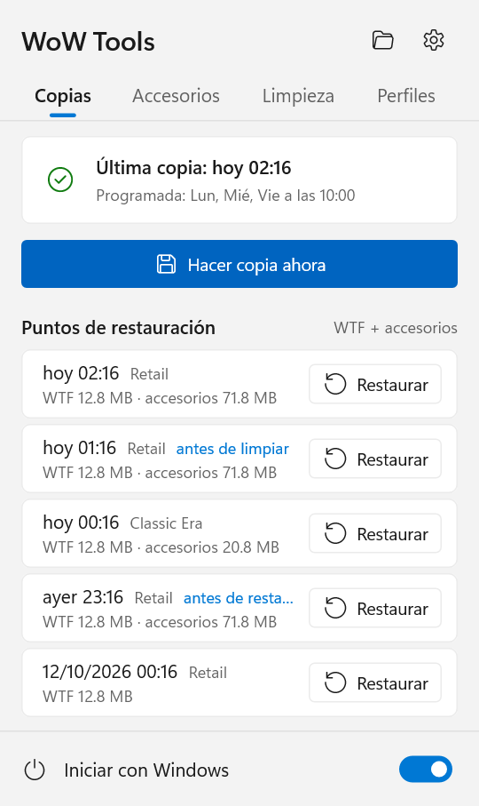
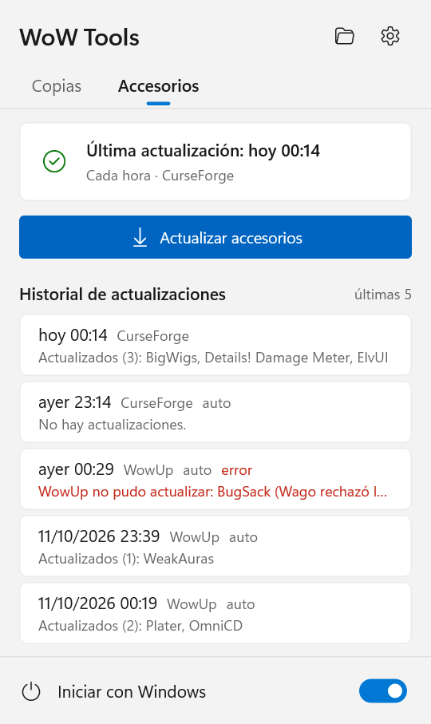
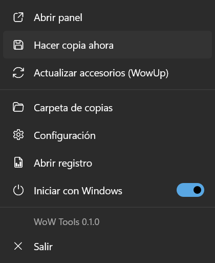
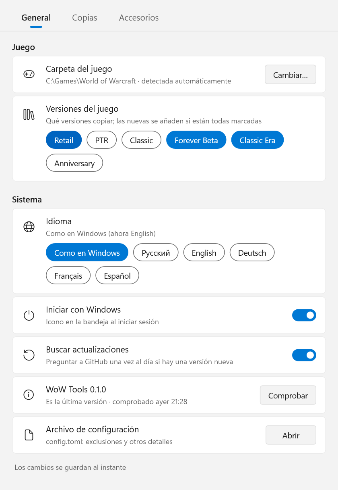
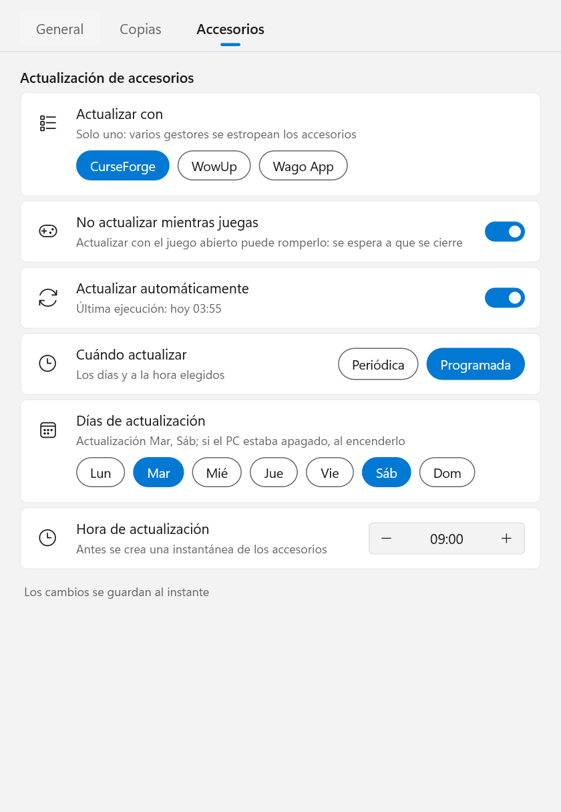

# WoW Tools

[English](README.md) · [Русский](README.ru.md) · [Deutsch](README.de.md) · [Français](README.fr.md) · **Español**

Una pequeña aplicación de bandeja de Windows para World of Warcraft que mantiene a salvo tu configuración y tus addons:

- **Copias de seguridad** de `WTF` (atajos de teclado, macros, chat, CVars, configuración de addons) e `Interface\AddOns`:
  tras cada sesión de juego o de forma programada, para todas las versiones del juego que tengas instaladas.
- **Restauración con un clic** a cualquier punto anterior, guardando antes el estado actual, así que una restauración
  siempre se puede deshacer.
- **Copia de la configuración entre personajes**: atajos, macros, ventanas de chat, disposición de marcos, addons
  activados, configuración de addons.
- **Actualización de addons** con el gestor que ya usas (CurseForge, WowUp, WowUp-CF o Wago App), iniciado sin ventana,
  de forma programada y nunca mientras juegas.
- Se actualiza solo: consulta GitHub una vez al día e instala una nueva versión con un clic.
- En inglés, ruso, alemán, francés y español.

<p>
  
  
  
</p>

## Contenido

- [Requisitos](#requisitos)
- [Instalación](#instalación)
- [El icono de la bandeja y el panel](#el-icono-de-la-bandeja-y-el-panel)
- [Configuración](#configuración)
- [Copias de seguridad: cómo funcionan](#copias-de-seguridad-cómo-funcionan)
- [Restauración](#restauración)
- [Actualización de addons](#actualización-de-addons)
- [Copiar la configuración entre personajes](#copiar-la-configuración-entre-personajes)
- [Línea de comandos](#línea-de-comandos)
- [Archivos y carpetas](#archivos-y-carpetas)
- [Privacidad y seguridad](#privacidad-y-seguridad)
- [Actualizar WoW Tools](#actualizar-wow-tools)
- [Desinstalación](#desinstalación)
- [Preguntas frecuentes y limitaciones](#preguntas-frecuentes-y-limitaciones)
- [Compilar desde el código fuente](#compilar-desde-el-código-fuente)

## Requisitos

- **Windows 10 u 11**, de 64 bits. No hace falta instalar nada más: es un único `.exe` sin dependencias.
- **World of Warcraft** instalado con Battle.net. Todas las versiones del juego son compatibles: Retail, Classic
  (progresión), Classic Era / Hardcore / Season of Discovery, Anniversary, PTR, beta y versiones que aún no existen:
  cualquier cosa en una carpeta `_name_` junto a `_retail_`.
- Solo para actualizar addons, **uno** de estos programas, instalado y configurado (con sesión iniciada y la carpeta del
  juego elegida):
  - la aplicación [CurseForge](https://www.curseforge.com/download/app);
  - [WowUp](https://wowup.io/) o WowUp-CF (la versión con CurseForge);
  - [Wago App](https://addons.wago.io/app), solo para WeakAuras y paquetes de interfaz, mira [más abajo](#wago-app).

  Las copias de seguridad, la restauración y la copia entre personajes funcionan sin ninguno de ellos.

## Instalación

1. Descarga `WoW-Tools-x.y.z.exe` desde [Releases](https://github.com/Gronck2/wow-tools/releases).
2. Ponlo en una carpeta fija (por ejemplo `%LOCALAPPDATA%\Programs\WoW Tools\`): el inicio automático recuerda esta ruta.
3. Ejecútalo. Aparece un icono en la bandeja; la carpeta del juego se detecta automáticamente (registro, Battle.net,
   rutas habituales).

Windows SmartScreen puede avisar de un editor desconocido porque el exe no está firmado: elige
**Más información → Ejecutar de todas formas**. Cada versión publicada indica el SHA-256 del archivo para que puedas
comprobar lo que has descargado (`Get-FileHash .\WoW-Tools-0.1.0.exe`).

Si vuelves a abrir el exe mientras ya se está ejecutando, se abre la ventana de configuración.

## El icono de la bandeja y el panel

El icono muestra el estado actual:

| Icono | Significado |
| --- | --- |
| verde | todo va bien |
| anillo | el juego está abierto, la copia se hará al cerrarlo |
| azul | trabajando: copia, restauración o actualización de addons |
| rojo | la última operación falló (pasa el ratón por el icono o abre el panel para ver por qué) |
| gris | aún no hay copias |

**Clic izquierdo** abre el panel (estilo Windows 11, sigue el tema claro/oscuro y el color de énfasis):

- Pestaña **Copias**: cuándo se hizo la última copia y cuándo se hacen las copias, **Hacer copia ahora** y los últimos
  puntos de restauración de cada versión del juego con un botón **Restaurar** (se confirma en la misma fila).
- Pestaña **Accesorios**: cuándo se actualizaron los addons por última vez, **Actualizar accesorios** y las cuatro
  últimas actualizaciones: qué se actualizó o qué salió mal (pasa el ratón por una fila para ver el texto completo).
- Arriba: la carpeta de copias y la configuración; abajo: **Iniciar con Windows**.

**Clic derecho** abre el menú: el panel, hacer copia ahora, actualizar addons, carpeta de copias, configuración,
registro, inicio automático, salir.

Se muestran notificaciones con el resultado de lo que inicias tú mismo y con los errores nuevos.

## Configuración

<p>
  
  
</p>

Cada cambio se guarda al instante y se aplica sin reiniciar.

- **General**: carpeta del juego (se detecta automáticamente, se puede elegir a mano), qué versiones del juego copiar,
  idioma, inicio con Windows, **Buscar actualizaciones** y la versión actual con **Comprobar** / **Instalar**, y un
  enlace a `config.toml` para las opciones que rara vez se necesitan.
- **Copias**: cuándo hacer la copia (*Tras el juego*, al cerrarlo, o *Programada*: los días de la semana elegidos a una
  hora fija), cuántas instantáneas conservar, los interruptores **Copiar accesorios** y **Esperar a que se cierre el juego**,
  la carpeta de copias.
- **Accesorios**: el programa con el que actualizar, **No actualizar mientras juegas**, **Actualizar automáticamente** y
  cuándo: *Periódica* (cada 30 min … 12 h) o *Programada* (días y hora).

## Copias de seguridad: cómo funcionan

- Una **instantánea** es un archivo zip de una carpeta: `WTF` e `Interface\AddOns` se archivan por separado, y cada
  versión del juego también por separado. Dentro, las rutas son relativas a la carpeta de la versión del juego.
- Una instantánea se crea **solo si algo ha cambiado**: WoW Tools recuerda una huella de la carpeta (rutas de archivos,
  tamaños, fechas de modificación) y omite las que no han cambiado. Los addons, que cambian poco, casi no cuestan nada.
- **Mientras una versión del juego está abierta, sus instantáneas se omiten**: WoW escribe `WTF` y la configuración de
  los addons al cerrar sesión o salir, así que una copia hecha durante la partida estaría a medias. Las demás versiones
  se copian como siempre. En el modo *Tras el juego* la copia se hace unos segundos después de cerrar el cliente.
- **Programada**: si el ordenador estaba apagado a la hora prevista, la copia se hace al encenderlo; si el juego estaba
  abierto, justo al cerrarlo. Una copia manual cuenta como programada.
- **Conservación**: se guardan las últimas `keep` instantáneas (30 por defecto) de cada serie; las más antiguas se
  eliminan.
- Los archivos `*.bak` y `*.old` se excluyen (por eso un `WTF` de 155 MB suele quedarse en unos 13 MB). La lista está en
  `exclude_ext` de `config.toml`.

## Restauración

**Restaurar** en el panel devuelve `WTF` y los addons de esa versión del juego a ese momento. Esa versión del juego debe
estar cerrada (las demás pueden estar abiertas). Antes de reemplazar nada, el estado actual se guarda como una
instantánea con la etiqueta *antes de restaurar*, así que siempre puedes volver atrás.

La restauración descomprime el archivo en una carpeta temporal junto a la real y solo entonces intercambia las
carpetas, así que una restauración interrumpida nunca deja un `WTF` a medio escribir.

Los puntos con la etiqueta *antes de actualizar* contienen solo addons: deshacen una actualización de addons y dejan la
configuración como está.

Desde la línea de comandos: `wow-tools restore` (la última), `wow-tools restore 20261012` (la última de ese día o
anterior), `--kind wtf` o `--kind addons` para una sola parte, `--flavor _classic_era_` para otra versión del juego.

## Actualización de addons

WoW Tools no descarga addons por sí mismo. Ejecuta el gestor de addons que ya tienes, deja que haga su actualización
habitual y lo cierra. Así los registros del propio gestor siguen siendo correctos y se respeta a los autores que solo
permiten descargas a través de los clientes oficiales.

Solo se usa **un** programa: dos gestores trabajando sobre la misma carpeta `AddOns` se sobrescriben los archivos. Si
tienes varios, elige uno en **Configuración → Accesorios**; si solo hay uno, se usa automáticamente.

En cada ejecución, automática o manual:

1. Con **No actualizar mientras juegas** activado (opción por defecto), no se hace nada mientras haya algún cliente del
   juego abierto; la actualización espera a que se cierre el juego.
2. Se crea una instantánea de `AddOns` con la etiqueta *antes de actualizar*: un clic en el panel deshace la
   actualización.
3. El programa se inicia sin ventana, actualiza y se cierra. **Si ya tenías el programa abierto, no se toca**: no se
   inicia por segunda vez ni se cierra.
4. El resultado va al historial de actualizaciones: qué addons se actualizaron, cuáles siguen pendientes (por ejemplo,
   los que tienen actualización manual en el programa) o por qué falló.

Si la actualización automática está desactivada en el programa, se activa solo para esta ejecución y luego se vuelve a
desactivar (aunque la ejecución se interrumpa: se deshace la próxima vez). Los addons que tengas en manual o ignorados
en el programa no se tocan.

### CurseForge

Se inicia con `--minimized` (en su bandeja, igual que en su propio inicio automático). WoW Tools sigue su registro hasta
que termina la búsqueda de actualizaciones y no se ha instalado nada durante un minuto (10 minutos como máximo), y
entonces lo cierra.

### WowUp y WowUp-CF

Se inicia con `--hidden --quit`: una ronda silenciosa de actualización automática y luego se cierra solo. WowUp solo
actualiza los addons que tienen activada la actualización automática; WoW Tools la activa para esta ejecución en todos
los addons que no estén ignorados.

> **Addons de Wago a través de WowUp.** WowUp normal obtiene el permiso de descarga de Wago del anuncio que muestra en su
> ventana. Iniciado sin ventana, no lo obtiene y Wago rechaza la descarga. Esos addons aparecen en el historial con este
> motivo. Actualízalos abriendo WowUp, configura una clave de Wago en los ajustes de WowUp o usa CurseForge / WowUp-CF si la mayoría de tus addons vienen de allí.

### Wago App

Wago App no permite actualizar addons de forma desatendida (solo con su botón *Update All*), así que, como programa
elegido, actualiza **solo WeakAuras y paquetes de interfaz**. Al elegirlo aparecen dos interruptores: **WeakAuras** y
**paquetes de interfaz**. La aplicación se inicia minimizada, escribe sus actualizaciones en `AddOns\WagoAppCompanion`
(WeakAuras, se aplican en el juego) y `AddOns\WagoUI_Storage` (paquetes de interfaz), y se cierra tras 15 segundos sin
actividad. La parte que hayas desactivado se queda exactamente como estaba. Con las dos desactivadas no hay nada que
hacer y la aplicación no se inicia.

## Copiar la configuración entre personajes

Los personajes están en `WTF\Account\<ACCOUNT>\<Realm>\<Name>`. Para copiar la configuración de un personaje a otros:

```
wow-tools chars
wow-tools copy-char --from "Tarren Mill/Groncky" --to "Kazzak/Groncky" --dry-run
wow-tools copy-char --from "Tarren Mill/Groncky" --to "Kazzak/Groncky" --to "Silvermoon/Gronckowski" --parts bindings,macros,savedvars
```

| Parte | Qué | Archivo |
| --- | --- | --- |
| `bindings` | atajos de teclado | `bindings-cache.wtf` |
| `macros` | macros del personaje | `macros-cache.txt` |
| `chat` | ventanas y canales de chat | `chat-cache.txt` |
| `config` | CVars del personaje | `config-cache.wtf` |
| `layout` | posiciones de los marcos | `layout-local.txt` |
| `addons` | qué addons están activados | `AddOns.txt` |
| `savedvars` | configuración de addons del personaje | `SavedVariables\*.lua` |

Sin `--parts` se copia todo. Los nombres no distinguen mayúsculas y minúsculas (también en cirílico); si un nombre
existe en varias cuentas, escribe `ACCOUNT/Realm/Name`. Antes, `WTF` se guarda como instantánea *antes de copiar*, y
esa versión del juego debe estar cerrada.

Los atajos y las macros pueden guardarse en los servidores de Blizzard (CVars `synchronizeBindings` /
`synchronizeMacros`); en ese caso, la copia del servidor puede sobrescribir los archivos copiados al iniciar sesión.

## Línea de comandos

`wow-tools` sin comando inicia el icono de la bandeja. Todo lo demás también está disponible desde una consola:

| Comando | Qué hace |
| --- | --- |
| `init [--wow-path DIR] [--backup-dir DIR]` | crea la configuración (la carpeta del juego se detecta automáticamente) |
| `status` | la instalación encontrada, versiones del juego, configuración, programas de addons y actualizaciones pendientes |
| `backup [--flavor F] [--kind wtf\|addons] [--force]` | crea una instantánea (solo de lo que ha cambiado, salvo con `--force`) |
| `list [--flavor F] [--kind K]` | lista las instantáneas |
| `restore [ID\|DATE\|latest] [--kind K] [--flavor F] [-y]` | restaura, guardando antes el estado actual |
| `chars [--flavor F]` | lista los personajes |
| `copy-char --from C --to C [--to C…] [--parts …] [--dry-run]` | copia la configuración entre personajes |
| `update-addons` | actualiza los addons ahora con el programa elegido |
| `watch [--interval N]` | lo mismo que el icono de la bandeja, en una ventana de consola |
| `schedule logon [--headless]` | inicia la bandeja al iniciar sesión (`--headless`: `watch` sin icono) |
| `schedule interval [--every MIN]` | una tarea del Programador de tareas que ejecuta `backup` cada N minutos (una vez al día por defecto) |
| `schedule status` / `schedule remove` | muestra / quita el inicio automático y la tarea |
| `self-update [--check]` | busca en GitHub una nueva versión de WoW Tools y la instala |

Opciones comunes: `--config FILE` (otra configuración), `--log-to-file`, `-v`. `wow-tools <comando> --help` explica el
resto en el idioma elegido.

## Archivos y carpetas

| Ruta | Qué |
| --- | --- |
| `%APPDATA%\WoW Tools\config\config.toml` | configuración |
| `%LOCALAPPDATA%\WoW Tools\data\backups\<version>\wtf\*.zip`, `...\addons\*.zip` | instantáneas (la carpeta se puede cambiar) |
| `%LOCALAPPDATA%\WoW Tools\data\wow-tools.log` | registro de la bandeja |
| `%LOCALAPPDATA%\WoW Tools\data\addon-updates.json` | historial de actualizaciones (las 20 últimas) |
| `%LOCALAPPDATA%\WoW Tools\data\self-update.json` | cuándo buscó WoW Tools una nueva versión por última vez |

Las instantáneas se llaman `YYYYmmdd-HHMMSS[-label].zip`; son archivos zip normales y se pueden abrir a mano.

`config.toml` también guarda lo que la ventana no muestra: `exclude_ext` (extensiones excluidas, `["bak", "old"]` por
defecto) y `language` (`ru`, `en`, `de`, `fr`, `es`; si no está = el idioma de Windows).

## Privacidad y seguridad

- La única conexión que WoW Tools establece por sí mismo es con **GitHub**, para buscar una nueva versión de WoW Tools
  (mira [Actualizar WoW Tools](#actualizar-wow-tools)): una vez al día, y se puede desactivar. Es una simple consulta de
  la última versión publicada, como abrir la página de versiones en el navegador; no se envía nada sobre ti, tu juego ni
  tus addons.
- Los addons solo los descarga el programa de addons que hayas elegido, nunca WoW Tools.
- Nunca toca el juego en sí, no lee la memoria del juego y no automatiza nada dentro del juego.
- Solo escribe en la carpeta del juego cuando restauras, copias la configuración de un personaje o un programa de addons
  actualiza los addons, y en todos estos casos crea antes una instantánea.

## Actualizar WoW Tools

WoW Tools consulta las [versiones publicadas](https://github.com/Gronck2/wow-tools/releases) de este repositorio una vez
al día (y cuando pulsas **Comprobar** en **Configuración → General**). Cuando hay una versión más nueva:

- aparece una notificación una sola vez;
- el panel muestra un botón con el número de la nueva versión junto a los iconos de la carpeta y de la configuración;
- el menú muestra **Actualizar a x.y.z** y la configuración, **Instalar**.

Un clic descarga el nuevo exe, lo comprueba con la suma SHA-256 que GitHub publica para el archivo de la versión (un
archivo que no coincide nunca se instala), lo pone en lugar del actual y reinicia la bandeja. El exe antiguo se guarda
como `<name>.exe.old` hasta el siguiente inicio y luego se elimina. Si hay una copia o una actualización en curso, el
reinicio espera a que termine. Tu configuración, tus instantáneas y el inicio automático quedan como estaban.

Desde la línea de comandos: `wow-tools self-update --check` (solo comprobar) o `wow-tools self-update` (comprobar e
instalar; después reinicia la bandeja). Para dejar de comprobar, desactiva **Buscar actualizaciones** en
**Configuración → General** (`check_updates = false` en `config.toml`).

## Desinstalación

1. Desactiva **Iniciar con Windows** (o ejecuta `wow-tools schedule remove`, que también quita la tarea programada).
2. Elige **Salir** en el menú de la bandeja.
3. Borra el exe y, si no necesitas la configuración ni las instantáneas, `%APPDATA%\WoW Tools` y
   `%LOCALAPPDATA%\WoW Tools`.

## Preguntas frecuentes y limitaciones

- **La restauración dice que el juego está abierto.** Cierra esa versión del juego (el lanzador de Battle.net puede
  seguir abierto).
- **Los atajos copiados desaparecieron al iniciar sesión.** Se sincronizan con el servidor; mira
  [más arriba](#copiar-la-configuración-entre-personajes).
- **La actualización dice «No hay actualizaciones», pero el programa muestra actualizaciones.** Esos addons están en
  manual o ignorados en el programa, o (en WowUp) vienen de Wago: mira el motivo en la fila del historial.
- **¿Se pueden usar varios programas de addons a la vez?** No, a propósito: se estropean los addons unos a otros.
- **¿Dónde se busca la carpeta del juego?** En el registro, en la lista de instalaciones de Battle.net y luego en las
  rutas habituales (`C:\Program Files (x86)\World of Warcraft`, `X:\Games\World of Warcraft`, …). También se encuentran
  las versiones del juego que Battle.net haya instalado en otras carpetas. Si no, elígela en
  **Configuración → General**.

## Compilar desde el código fuente

```
cargo build --release
```

Rust stable, Windows. La CI (GitHub Actions) comprueba el formato, clippy, los tests y la compilación en cada push; una
etiqueta `vX.Y.Z` que coincida con la versión de `Cargo.toml` compila el exe y crea un borrador de versión. Los textos
están en `locales/<idioma>.toml`.
