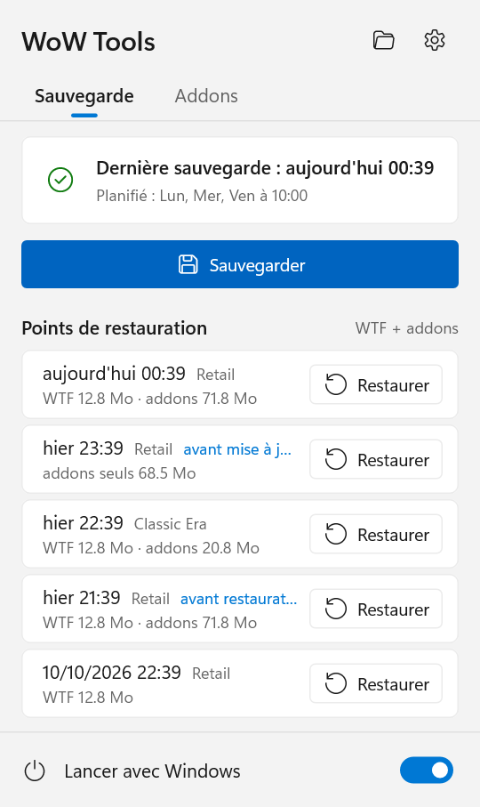
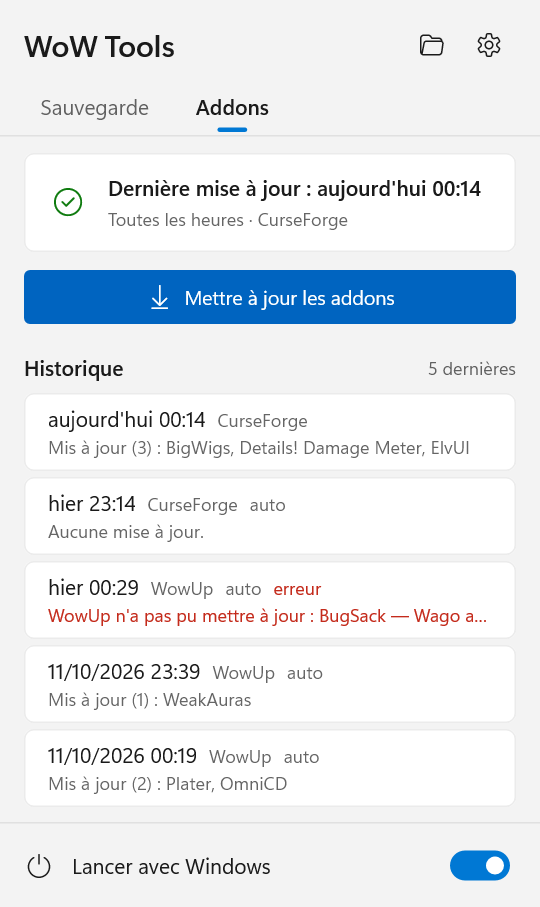
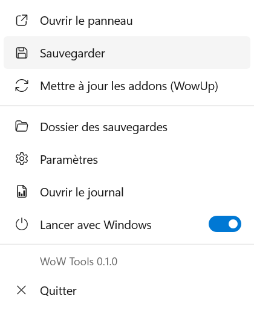
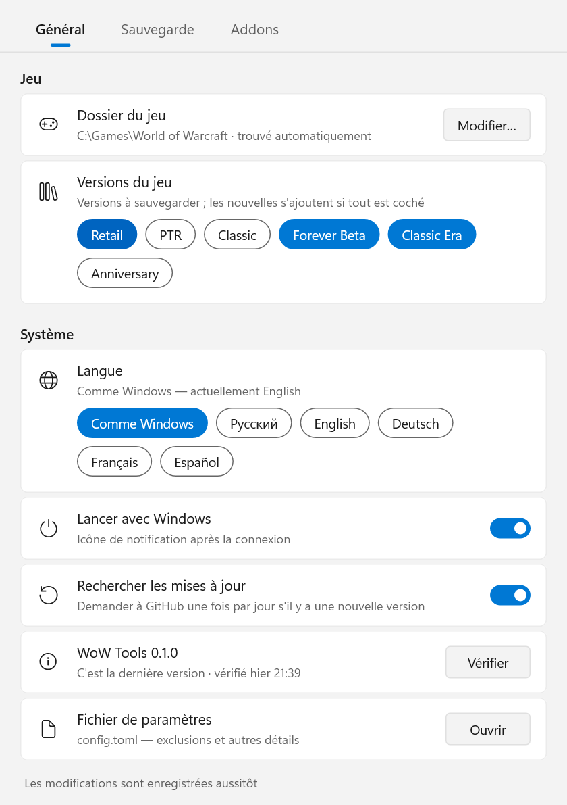
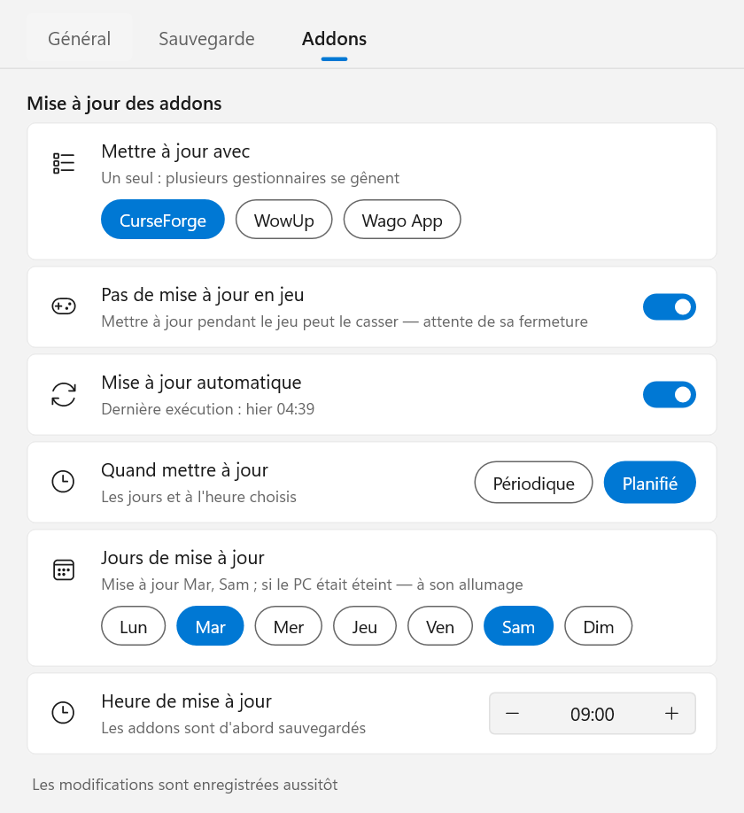

# WoW Tools

[English](README.md) · [Русский](README.ru.md) · [Deutsch](README.de.md) · **Français** · [Español](README.es.md)

Une petite application Windows pour World of Warcraft, dans la zone de notification, qui met vos réglages et vos addons
à l'abri :

- **Sauvegardes** de `WTF` (raccourcis clavier, macros, discussion, CVars, réglages des addons) et de `Interface\AddOns`
  — après chaque session de jeu ou selon un planning, pour toutes les versions du jeu installées.
- **Restauration en un clic** vers n'importe quel point antérieur, l'état actuel étant d'abord enregistré : une
  restauration peut toujours être annulée.
- **Copie des réglages entre personnages** : raccourcis, macros, fenêtres de discussion, disposition des cadres, addons
  activés, réglages des addons.
- **Mise à jour des addons** via le gestionnaire que vous utilisez déjà — CurseForge, WowUp, WowUp-CF ou Wago App —
  lancé sans fenêtre, selon un planning, jamais pendant que vous jouez.
- Mise à jour automatique de l'application : vérification sur GitHub une fois par jour et installation d'une nouvelle
  version en un clic.
- Anglais, russe, allemand, français et espagnol.

<p>
  
  
  
</p>

## Sommaire

- [Prérequis](#prérequis)
- [Installation](#installation)
- [L'icône de notification et le panneau](#licône-de-notification-et-le-panneau)
- [Paramètres](#paramètres)
- [Fonctionnement des sauvegardes](#fonctionnement-des-sauvegardes)
- [Restauration](#restauration)
- [Mise à jour des addons](#mise-à-jour-des-addons)
- [Copier les réglages entre personnages](#copier-les-réglages-entre-personnages)
- [Ligne de commande](#ligne-de-commande)
- [Fichiers et dossiers](#fichiers-et-dossiers)
- [Confidentialité et sécurité](#confidentialité-et-sécurité)
- [Mettre à jour WoW Tools](#mettre-à-jour-wow-tools)
- [Désinstallation](#désinstallation)
- [FAQ et limites](#faq-et-limites)
- [Compiler depuis les sources](#compiler-depuis-les-sources)

## Prérequis

- **Windows 10 ou 11**, 64 bits. Rien d'autre à installer : c'est un seul `.exe`, sans dépendance d'exécution.
- **World of Warcraft** installé via Battle.net. Toutes les versions du jeu sont prises en charge : Retail, Classic
  (progression), Classic Era / Hardcore / Season of Discovery, Anniversary, PTR, bêta, et même les versions qui
  n'existent pas encore — tout dossier `_nom_` placé à côté de `_retail_`.
- Pour la mise à jour des addons uniquement — **un** de ces programmes, installé et configuré (compte connecté,
  dossier du jeu choisi) :
  - l'application [CurseForge](https://www.curseforge.com/download/app) ;
  - [WowUp](https://wowup.io/) ou WowUp-CF (la version avec CurseForge) ;
  - [Wago App](https://addons.wago.io/app) — uniquement pour WeakAuras et les packs d'interface, voir [plus bas](#wago-app).

  Les sauvegardes, la restauration et la copie entre personnages fonctionnent sans aucun d'eux.

## Installation

1. Téléchargez `WoW-Tools-x.y.z.exe` depuis les [Releases](https://github.com/Gronck2/wow-tools/releases).
2. Placez-le dans un dossier définitif (par exemple `%LOCALAPPDATA%\Programs\WoW Tools\`) — le démarrage automatique
   retient ce chemin.
3. Lancez-le. Une icône apparaît dans la zone de notification ; le dossier du jeu est trouvé automatiquement (registre,
   Battle.net, chemins courants).

Windows SmartScreen peut signaler un éditeur inconnu, car l'exe n'est pas signé : choisissez
**Informations complémentaires → Exécuter quand même**. Chaque release indique le SHA-256 du fichier pour vérifier ce
que vous avez téléchargé (`Get-FileHash .\WoW-Tools-0.1.0.exe`).

Relancer l'exe alors qu'il tourne déjà ouvre la fenêtre des paramètres.

## L'icône de notification et le panneau

L'icône indique l'état actuel :

| Icône | Signification |
| --- | --- |
| verte | tout va bien |
| anneau | le jeu est lancé, la sauvegarde se fera après sa fermeture |
| bleue | travail en cours : sauvegarde, restauration ou mise à jour des addons |
| rouge | la dernière opération a échoué (survolez l'icône ou ouvrez le panneau pour savoir pourquoi) |
| grise | aucune sauvegarde pour l'instant |

Le **clic gauche** ouvre le panneau (style Windows 11, suit le thème clair/sombre et la couleur d'accentuation) :

- Onglet **Sauvegarde** : l'heure de la dernière sauvegarde et quand les sauvegardes ont lieu, **Sauvegarder**, et les
  derniers points de restauration de chaque version du jeu avec un bouton **Restaurer** (confirmation directement dans
  la ligne).
- Onglet **Addons** : la date de la dernière mise à jour des addons, **Mettre à jour les addons**, et les cinq
  dernières mises à jour — ce qui a été mis à jour ou ce qui a échoué (survolez une ligne pour voir le texte complet).
- En haut : le dossier des sauvegardes et les paramètres ; en bas : **Lancer avec Windows**.

Le **clic droit** ouvre le menu : le panneau, sauvegarder, mettre à jour les addons, dossier des sauvegardes,
paramètres, journal, démarrage automatique, quitter.

Des notifications s'affichent pour le résultat de ce que vous avez lancé vous-même et pour les nouvelles erreurs.

## Paramètres

<p>
  
  
</p>

Chaque modification est enregistrée aussitôt et appliquée sans redémarrage.

- **Général** : dossier du jeu (trouvé automatiquement, modifiable à la main), versions du jeu à sauvegarder, langue,
  lancement avec Windows, **Rechercher les mises à jour** et la version actuelle avec **Vérifier** / **Installer**, et
  un lien vers `config.toml` pour les options rarement utiles.
- **Sauvegarde** : quand sauvegarder (*Après le jeu*, à sa fermeture, ou *Planifié* — les jours choisis à une heure
  donnée), nombre de sauvegardes à conserver, les interrupteurs **Sauvegarder les addons** et **Attendre la fermeture du jeu**,
  dossier des sauvegardes.
- **Addons** : le programme de mise à jour, **Pas de mise à jour en jeu**, **Mise à jour automatique**, et quand —
  *Périodique* (toutes les 30 min … 12 h) ou *Planifié* (jours et heure).

## Fonctionnement des sauvegardes

- Une **sauvegarde** est une archive zip d'un dossier : `WTF` et `Interface\AddOns` sont archivés séparément, et
  chaque version du jeu à part. À l'intérieur, les chemins sont relatifs au dossier de la version du jeu.
- Une sauvegarde n'est créée **que si quelque chose a changé** : WoW Tools retient une empreinte du dossier (chemins,
  tailles et dates de modification des fichiers) et ignore les dossiers inchangés. Les addons, qui changent rarement,
  ne coûtent presque rien.
- **Tant qu'une version du jeu est lancée, ses sauvegardes sont ignorées** : WoW écrit `WTF` et les réglages des addons
  à la déconnexion ou en quittant, une copie faite en cours de partie serait donc à moitié périmée. Les autres versions
  sont sauvegardées normalement. En mode *Après le jeu*, la sauvegarde a lieu quelques secondes après la fermeture du
  client.
- **Planifié** : si l'ordinateur était éteint à l'heure prévue, la sauvegarde se fait à son allumage ; si le jeu était
  lancé, juste après sa fermeture. Une sauvegarde manuelle compte comme une sauvegarde planifiée.
- **Conservation** : les `keep` dernières sauvegardes (30 par défaut) de chaque série sont conservées, les plus
  anciennes sont supprimées.
- Les fichiers `*.bak` et `*.old` sont exclus (c'est pourquoi un `WTF` de 155 Mo tient généralement dans ~13 Mo). La
  liste se règle avec `exclude_ext` dans `config.toml`.

## Restauration

**Restaurer** dans le panneau ramène `WTF` et les addons de cette version du jeu à ce moment-là. La version du jeu
concernée doit être fermée (les autres peuvent tourner). Avant tout remplacement, l'état actuel est enregistré dans une
sauvegarde étiquetée *avant restauration* : vous pouvez toujours revenir en arrière.

La restauration extrait l'archive dans un dossier temporaire à côté du vrai, puis échange les dossiers : une
restauration interrompue ne laisse jamais un `WTF` à moitié écrit.

Les points étiquetés *avant mise à jour* ne contiennent que les addons — ils annulent une mise à jour des addons et
laissent les réglages tels quels.

En ligne de commande : `wow-tools restore` (la plus récente), `wow-tools restore 20261012` (la plus récente de ce jour
ou d'avant), `--kind wtf` ou `--kind addons` pour une seule partie, `--flavor _classic_era_` pour une autre version du
jeu.

## Mise à jour des addons

WoW Tools ne télécharge pas les addons lui-même. Il lance le gestionnaire d'addons que vous avez déjà, le laisse faire
sa mise à jour habituelle, puis le ferme. Les données du gestionnaire restent ainsi correctes, et les auteurs qui
n'autorisent le téléchargement que via les clients officiels sont respectés.

Un **seul** programme est utilisé : deux gestionnaires qui travaillent sur le même dossier `AddOns` écrasent les
fichiers l'un de l'autre. Si vous en avez plusieurs, choisissez-en un dans **Paramètres → Addons** ; s'il n'y en a
qu'un, il est utilisé automatiquement.

À chaque exécution, automatique ou manuelle :

1. Avec **Pas de mise à jour en jeu** activé (par défaut), rien ne se passe tant qu'un client du jeu tourne ; la mise
   à jour attend la fermeture du jeu.
2. Une sauvegarde de `AddOns` étiquetée *avant mise à jour* est créée — un clic dans le panneau suffit à annuler la
   mise à jour.
3. Le programme est lancé sans fenêtre, fait la mise à jour, puis est fermé. **Un programme que vous aviez déjà ouvert
   n'est pas touché** — il n'est ni relancé, ni fermé.
4. Le résultat va dans l'historique des mises à jour : les addons mis à jour, ceux qui attendent encore (par exemple
   réglés en mise à jour manuelle dans le programme), ou la raison de l'échec.

Si la mise à jour auto est désactivée dans le programme, elle est activée juste pour cette exécution puis désactivée
de nouveau (même si l'exécution a été interrompue — c'est rétabli la fois suivante). Les addons que vous avez réglés
en manuel ou ignorés dans le programme ne sont pas touchés.

### CurseForge

Lancé avec `--minimized` (dans sa zone de notification, comme le fait son propre démarrage automatique). WoW Tools suit
son journal jusqu'à ce que la recherche de mises à jour soit terminée et que rien n'ait été installé depuis une minute
(10 minutes au maximum), puis le ferme.

### WowUp et WowUp-CF

Lancé avec `--hidden --quit` : une passe de mise à jour auto silencieuse, puis il se ferme tout seul. WowUp ne met à
jour que les addons dont la mise à jour auto est activée ; WoW Tools l'active, pour cette exécution, pour tous les
addons non ignorés.

> **Addons Wago via WowUp.** WowUp standard obtient son autorisation de téléchargement Wago grâce à la publicité
> affichée dans sa fenêtre. Lancé sans fenêtre, il n'en obtient pas, et Wago refuse le téléchargement. Ces addons
> apparaissent dans l'historique avec cette raison. Mettez-les à jour en ouvrant WowUp, indiquez une clé Wago dans les
> paramètres de WowUp, ou utilisez CurseForge / WowUp-CF si la plupart de vos addons en viennent.

### Wago App

Wago App ne sait pas mettre à jour les addons sans intervention — seulement via son bouton *Update All* — donc, choisi
comme programme, il ne met à jour **que WeakAuras et les packs d'interface**. Deux interrupteurs apparaissent quand il
est choisi : **WeakAuras** et **packs d'interface**. L'application est lancée réduite, écrit ses mises à jour dans
`AddOns\WagoAppCompanion` (WeakAuras, à appliquer en jeu) et `AddOns\WagoUI_Storage` (packs d'interface), puis est
fermée après 15 secondes d'inactivité. Une partie que vous avez désactivée reste exactement telle qu'elle était. Si les
deux sont désactivées, il n'y a rien à faire et l'application n'est pas lancée.

## Copier les réglages entre personnages

Les personnages se trouvent dans `WTF\Account\<ACCOUNT>\<Realm>\<Name>`. Pour copier la configuration d'un personnage
vers d'autres :

```
wow-tools chars
wow-tools copy-char --from "Tarren Mill/Groncky" --to "Kazzak/Groncky" --dry-run
wow-tools copy-char --from "Tarren Mill/Groncky" --to "Kazzak/Groncky" --to "Silvermoon/Gronckowski" --parts bindings,macros,savedvars
```

| Partie | Contenu | Fichier |
| --- | --- | --- |
| `bindings` | raccourcis clavier | `bindings-cache.wtf` |
| `macros` | macros du personnage | `macros-cache.txt` |
| `chat` | fenêtres et canaux de discussion | `chat-cache.txt` |
| `config` | CVars du personnage | `config-cache.wtf` |
| `layout` | position des cadres | `layout-local.txt` |
| `addons` | addons activés | `AddOns.txt` |
| `savedvars` | réglages des addons du personnage | `SavedVariables\*.lua` |

Sans `--parts`, tout est copié. Les noms ne tiennent pas compte de la casse (cyrillique compris) ; si un nom existe sur
plusieurs comptes, écrivez `ACCOUNT/Realm/Name`. `WTF` est d'abord enregistré dans une sauvegarde *avant copie*, et la
version du jeu doit être fermée.

Les raccourcis clavier et les macros peuvent être stockés sur les serveurs de Blizzard (CVars `synchronizeBindings` /
`synchronizeMacros`) ; dans ce cas, la copie du serveur peut remplacer les fichiers copiés à la connexion.

## Ligne de commande

`wow-tools` sans commande lance l'icône de notification. Tout le reste est aussi disponible depuis une console :

| Commande | Ce qu'elle fait |
| --- | --- |
| `init [--wow-path DIR] [--backup-dir DIR]` | crée la configuration (le dossier du jeu est trouvé automatiquement) |
| `status` | l'installation trouvée, les versions du jeu, les paramètres, les programmes d'addons et les mises à jour en attente |
| `backup [--flavor F] [--kind wtf\|addons] [--force]` | crée une sauvegarde (seulement de ce qui a changé, sauf avec `--force`) |
| `list [--flavor F] [--kind K]` | liste les sauvegardes |
| `restore [ID\|DATE\|latest] [--kind K] [--flavor F] [-y]` | restaure, en enregistrant d'abord l'état actuel |
| `chars [--flavor F]` | liste les personnages |
| `copy-char --from C --to C [--to C…] [--parts …] [--dry-run]` | copie les réglages entre personnages |
| `update-addons` | met à jour les addons maintenant via le programme choisi |
| `watch [--interval N]` | ce que fait l'icône de notification, dans une fenêtre de console |
| `schedule logon [--headless]` | lance l'icône de notification à la connexion (`--headless` : `watch` sans icône) |
| `schedule interval [--every MIN]` | une tâche du Planificateur de tâches qui lance `backup` toutes les N minutes (une fois par jour par défaut) |
| `schedule status` / `schedule remove` | affiche / supprime le démarrage automatique et la tâche |
| `self-update [--check]` | cherche une nouvelle version de WoW Tools sur GitHub et l'installe |

Options communes : `--config FILE` (une autre configuration), `--log-to-file`, `-v`. `wow-tools <command> --help`
explique le reste dans la langue choisie.

## Fichiers et dossiers

| Chemin | Contenu |
| --- | --- |
| `%APPDATA%\WoW Tools\config\config.toml` | paramètres |
| `%LOCALAPPDATA%\WoW Tools\data\backups\<version>\wtf\*.zip`, `...\addons\*.zip` | sauvegardes (dossier modifiable) |
| `%LOCALAPPDATA%\WoW Tools\data\wow-tools.log` | journal de l'icône de notification |
| `%LOCALAPPDATA%\WoW Tools\data\addon-updates.json` | historique des mises à jour (20 dernières) |
| `%LOCALAPPDATA%\WoW Tools\data\self-update.json` | date de la dernière recherche d'une nouvelle version de WoW Tools |

Les sauvegardes sont nommées `YYYYmmdd-HHMMSS[-label].zip` ; ce sont des fichiers zip ordinaires, que l'on peut ouvrir
à la main.

`config.toml` contient aussi ce que la fenêtre n'affiche pas : `exclude_ext` (extensions exclues, `["bak", "old"]` par
défaut) et `language` (`ru`, `en`, `de`, `fr`, `es` ; absent = la langue d'affichage de Windows).

## Confidentialité et sécurité

- La seule connexion que WoW Tools établit lui-même est vers **GitHub**, pour chercher une nouvelle version de WoW
  Tools (voir [Mettre à jour WoW Tools](#mettre-à-jour-wow-tools)) — une fois par jour, et cela peut être désactivé.
  C'est une simple requête pour obtenir la dernière release, comme si vous ouvriez la page des releases dans un
  navigateur ; rien sur vous, votre jeu ou vos addons n'est envoyé.
- Les addons sont téléchargés uniquement par le programme d'addons que vous avez choisi, jamais par WoW Tools.
- Il ne touche jamais au jeu lui-même, ne lit pas la mémoire du jeu et n'automatise rien en jeu.
- Il n'écrit dans le dossier du jeu que lorsque vous restaurez, copiez les réglages d'un personnage, ou quand un
  programme d'addons met à jour les addons — et chacune de ces opérations crée d'abord une sauvegarde.

## Mettre à jour WoW Tools

WoW Tools consulte les [releases](https://github.com/Gronck2/wow-tools/releases) de ce dépôt une fois par jour (et
quand vous cliquez sur **Vérifier** dans **Paramètres → Général**). Quand une version plus récente existe :

- une notification s'affiche une fois ;
- le panneau affiche un bouton avec le numéro de la nouvelle version, à côté des icônes du dossier et des paramètres ;
- le menu propose **Mettre à jour vers x.y.z**, et les paramètres affichent **Installer**.

Un clic télécharge le nouvel exe, le vérifie avec la somme de contrôle SHA-256 que GitHub publie pour le fichier de la
release (un fichier qui ne correspond pas n'est jamais installé), le met à la place de l'actuel et redémarre l'icône de
notification. L'ancien exe est conservé sous le nom `<name>.exe.old` jusqu'au prochain démarrage, puis supprimé. Si une
sauvegarde ou une mise à jour est en cours, le redémarrage attend qu'elle se termine. Vos paramètres, vos sauvegardes
et le démarrage automatique restent tels quels.

En ligne de commande : `wow-tools self-update --check` (vérifier seulement) ou `wow-tools self-update` (vérifier et
installer ; redémarrez ensuite l'icône de notification). Pour ne plus vérifier, désactivez **Rechercher les mises à
jour** dans **Paramètres → Général** (`check_updates = false` dans `config.toml`).

## Désinstallation

1. Désactivez **Lancer avec Windows** (ou lancez `wow-tools schedule remove`, qui supprime aussi une éventuelle tâche
   planifiée).
2. Choisissez **Quitter** dans le menu de l'icône de notification.
3. Supprimez l'exe et, si vous n'avez plus besoin des paramètres ni des sauvegardes, `%APPDATA%\WoW Tools` et
   `%LOCALAPPDATA%\WoW Tools`.

## FAQ et limites

- **La restauration indique que le jeu est lancé.** Fermez cette version du jeu (le launcher Battle.net peut rester
  ouvert).
- **Les raccourcis copiés ont disparu après la connexion.** Ils sont synchronisés avec le serveur ; voir
  [plus haut](#copier-les-réglages-entre-personnages).
- **La mise à jour indique « Aucune mise à jour. », mais le programme affiche des mises à jour.** Ces addons sont
  réglés en manuel ou ignorés dans le programme, ou (WowUp) viennent de Wago — la ligne de l'historique en donne la
  raison.
- **Peut-on utiliser plusieurs programmes d'addons à la fois ?** Non, et c'est voulu : ils cassent les addons l'un de
  l'autre.
- **Où le dossier du jeu est-il cherché ?** Dans le registre, la liste des installations de Battle.net, puis les
  chemins habituels (`C:\Program Files (x86)\World of Warcraft`, `X:\Games\World of Warcraft`, …). Les versions du jeu
  que Battle.net a installées dans d'autres dossiers sont trouvées aussi. Sinon, indiquez-le dans
  **Paramètres → Général**.

## Compiler depuis les sources

```
cargo build --release
```

Rust stable, Windows. La CI (GitHub Actions) vérifie le formatage, clippy, les tests et la compilation à chaque push ;
un tag `vX.Y.Z` correspondant à la version de `Cargo.toml` compile l'exe et crée un brouillon de release. Les textes
sont dans `locales/<langue>.toml`.
