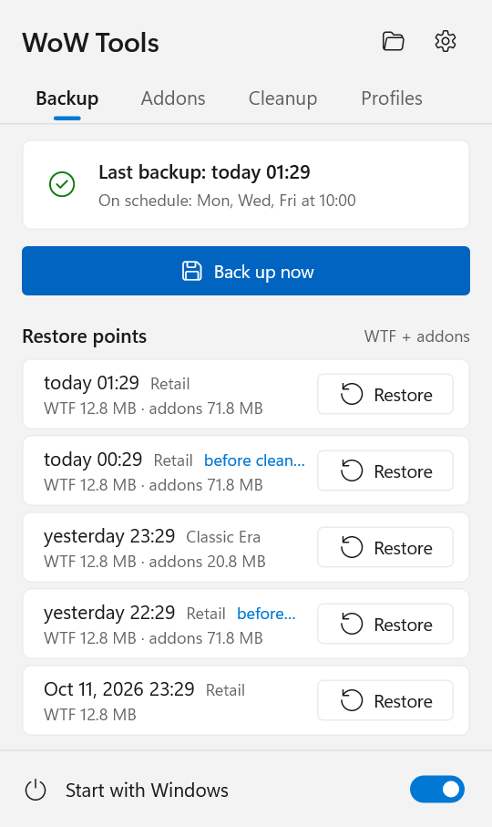
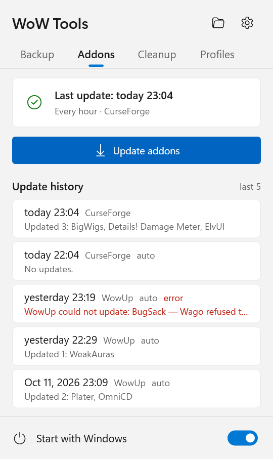
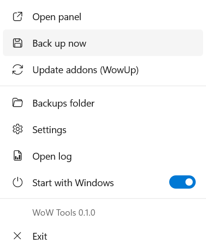
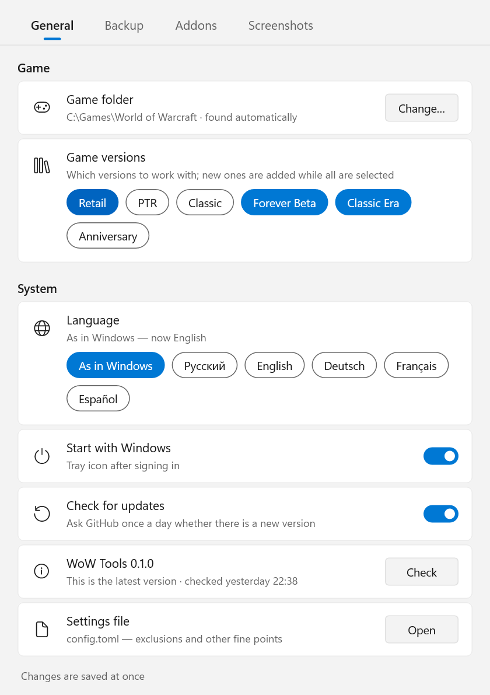
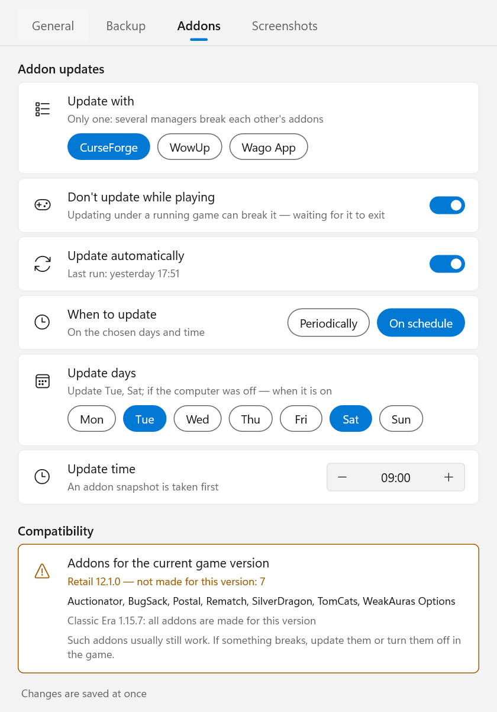
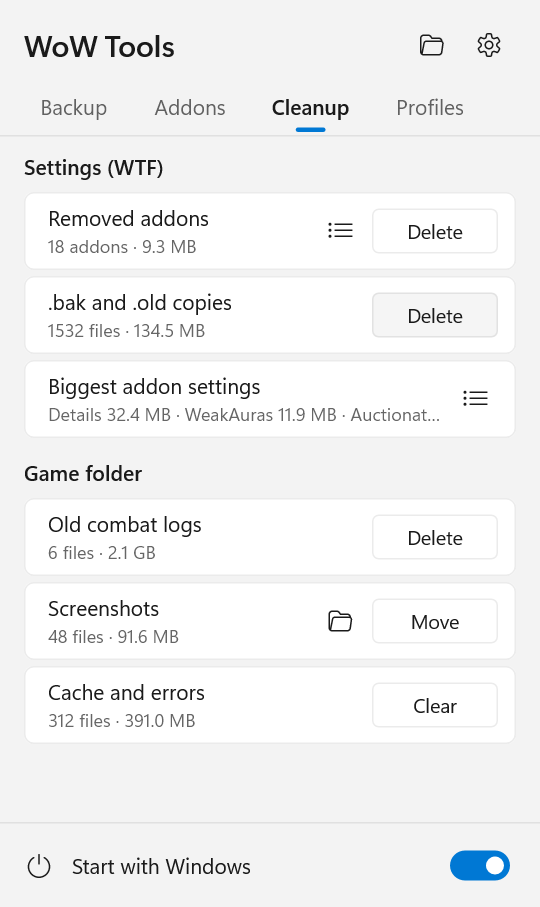
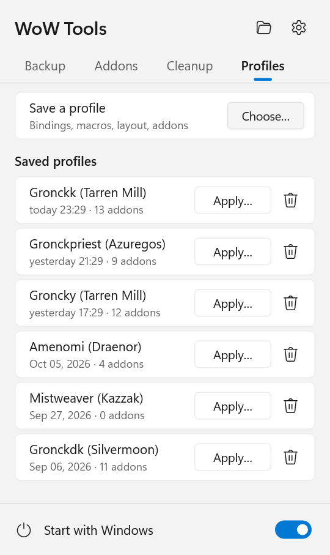

# WoW Tools

**English** · [Русский](README.ru.md) · [Deutsch](README.de.md) · [Français](README.fr.md) · [Español](README.es.md)

A small Windows tray app for World of Warcraft that keeps your settings and addons safe:

- **Backups** of `WTF` (key bindings, macros, chat, CVars, addon settings) and `Interface\AddOns` — after every game
  session or on a schedule, for every game version you have installed.
- **One-click restore** to any earlier point, with the current state saved first, so a restore can always be undone.
- **Copying settings between characters**: bindings, macros, chat windows, frame layout, enabled addons, addon settings.
- **Addon updates** through the addon manager you already use — CurseForge, WowUp, WowUp-CF or the Wago App —
  started without a window, on a schedule, never while you are playing.
- **Game patches**: when Battle.net updates the game, settings and addons are saved before its first start on the
  new version, and you see which addons are not made for it yet.
- **Cleanup**: settings of removed addons, WoW's `.bak` copies, old combat logs, screenshots and the cache — with
  sizes, in one click.
- **UI profiles**: save a character's interface (bindings, macros, layout, addons and their profiles) and put it
  on another character in two clicks.
- Updates itself: checks GitHub once a day and installs a new version in one click.
- English, Russian, German, French and Spanish.

<p>
  
  
  
</p>

## Contents

- [Requirements](#requirements)
- [Installation](#installation)
- [The tray icon and the panel](#the-tray-icon-and-the-panel)
- [Settings](#settings)
- [Backups: how they work](#backups-how-they-work)
- [Restoring](#restoring)
- [Addon updates](#addon-updates)
- [Game patches](#game-patches)
- [Cleanup](#cleanup)
- [UI profiles](#ui-profiles)
- [Copying settings between characters](#copying-settings-between-characters)
- [Command line](#command-line)
- [Files and folders](#files-and-folders)
- [Privacy and safety](#privacy-and-safety)
- [Updating WoW Tools](#updating-wow-tools)
- [Uninstalling](#uninstalling)
- [FAQ and limitations](#faq-and-limitations)
- [Building from source](#building-from-source)

## Requirements

- **Windows 10 or 11**, 64-bit. Nothing else to install: it is a single `.exe` with no runtime dependencies.
- **World of Warcraft** installed through Battle.net. Every game version is supported: Retail, Classic (progression),
  Classic Era / Hardcore / Season of Discovery, Anniversary, PTR, beta, and versions that do not exist yet — anything
  in a `_name_` folder next to `_retail_`.
- For addon updates only — **one** of these, installed and set up (signed in, game folder chosen):
  - [CurseForge](https://www.curseforge.com/download/app) app;
  - [WowUp](https://wowup.io/) or WowUp-CF (the CurseForge-enabled build);
  - [Wago App](https://addons.wago.io/app) — for WeakAuras and UI packs only, see [below](#wago-app).

  Backups, restore and character copying work without any of them.

## Installation

1. Download `WoW-Tools-x.y.z.exe` from [Releases](https://github.com/Gronck2/wow-tools/releases).
2. Put it in a permanent folder (for example `%LOCALAPPDATA%\Programs\WoW Tools\`) — autostart remembers this path.
3. Run it. A tray icon appears; the game folder is found automatically (registry, Battle.net, common paths).

Windows SmartScreen may warn about an unknown publisher because the exe is not code-signed: choose
**More info → Run anyway**. Each release lists the file's SHA-256 so you can check what you downloaded
(`Get-FileHash .\WoW-Tools-0.1.0.exe`).

Starting the exe again while it is running opens the settings window.

## The tray icon and the panel

The icon shows the current state:

| Icon | Meaning |
| --- | --- |
| grey emblem | the game is not running |
| gold emblem | the game is running (the backup will be taken after it exits) |
| blue dot | working: backup, restore, addon update, cleanup or a profile |
| red dot | the last operation failed (hover the icon or open the panel to see why) |

**Left click** opens the panel (Windows 11 style, follows the light/dark theme and the accent colour):

- **Backup** tab: when the last backup was taken and when backups run, **Back up now**, and the latest restore
  points of every game version with a **Restore** button (confirmed right in the row).
- **Addons** tab: when addons were last updated, **Update addons**, and the last five update runs — what was updated
  or what went wrong (hover a row for the full text).
- **Cleanup** tab: what can be tidied up in WTF and the game folder, with sizes and a button each — see
  [Cleanup](#cleanup).
- **Profiles** tab: saved UI profiles and **Save a profile** — see [UI profiles](#ui-profiles).
- At the top: the backups folder and the settings; at the bottom: **Start with Windows**.

**Right click** opens the menu: the panel, back up now, update addons, backups folder, settings, log, autostart, exit.

Notifications appear for the results of what you started yourself and for new errors.

## Settings

<p>
  
  
</p>

Every change is saved at once and applied without a restart.

- **General**: game folder (found automatically, can be set by hand), which game versions to work with (backups, cleanup, profiles), language,
  start with Windows, **Check for updates** and the current version with **Check** / **Install**, and a link to
  `config.toml` for the rarely needed options.
- **Backup**: when to back up (*after the game* closes, or *on schedule* — chosen weekdays at a set time), how many
  snapshots to keep, the **Back up addons** and **Wait for the game to exit** switches, the backups folder.
- **Addons**: the program to update with, **Don't update while playing**, **Update automatically**, and when —
  *periodically* (every 30 min … 12 h) or *on schedule* (days and time); below, every addon that is not made for the
  current game version (see [Game patches](#game-patches)).
- **Screenshots**: where the cleanup moves screenshots and how it sorts them (see [Cleanup](#cleanup)).

## Backups: how they work

- A **snapshot** is a zip archive of a folder: `WTF` and `Interface\AddOns` are archived separately, for each game
  version separately. Inside, paths are relative to the game version folder.
- A snapshot is taken **only if something changed**: WoW Tools remembers a fingerprint of the folder (file paths,
  sizes, modification times) and skips unchanged ones. Addons, which rarely change, cost almost nothing.
- **While a game version runs, its snapshots are skipped**: WoW writes `WTF` and addon settings when you log out or
  exit, so a copy made during play would be half old. Other versions are backed up as usual. In *after the game*
  mode the backup is taken a few seconds after the client closes.
- **On schedule**: if the computer was off at the scheduled time, the backup is taken when it is back on; if the game
  was running, right after it closes. A manual backup counts as a scheduled one.
- **Retention**: the latest `keep` snapshots (30 by default) of each series are kept, older ones are deleted.
- `*.bak` and `*.old` files are left out (that is why a 155 MB `WTF` usually fits in ~13 MB). The list is
  `exclude_ext` in `config.toml`.

## Restoring

**Restore** in the panel returns `WTF` and addons of that game version to that moment. The game version must be
closed (others may run). Before anything is replaced, the current state is saved as a snapshot labelled
*before restore*, so you can always go back.

A restore unpacks the archive into a temporary folder next to the real one and only then swaps the folders, so an
interrupted restore never leaves a half-written `WTF`.

The `AddOns` snapshots taken *before update* are not listed in the panel: `wow-tools list --kind addons` shows them,
`wow-tools restore <id> --kind addons` undoes an addon update and leaves settings as they are.

Before a cleanup, a UI profile or a settings copy a WTF snapshot is taken too (*before cleanup*, *before profile*,
*before copy*). It is a safety net: the panel lists only the ones *before cleanup*; several such actions within 10 minutes share the one
taken before the first. `wow-tools list --kind wtf` shows them, `wow-tools restore <id> --kind wtf` brings one back.

From the command line: `wow-tools restore` (latest), `wow-tools restore 20261012` (the latest of that day or earlier),
`--kind wtf` or `--kind addons` for one part only, `--flavor _classic_era_` for another game version.

## Addon updates

WoW Tools does not download addons itself. It runs the addon manager you already have, lets it do its usual update and
closes it. This keeps the manager's own records correct and respects authors who allow downloads only through official
clients.

Only **one** program is used: two managers working on the same `AddOns` folder overwrite each other's files. If you
have several, choose one in **Settings → Addons**; if there is just one, it is used automatically.

Every run, automatic or manual:

1. With **Don't update while playing** on (the default), nothing happens while any game client runs; the update waits
   until the game is closed.
2. An `AddOns` snapshot labelled *before update* is taken — `wow-tools restore <id> --kind addons` undoes the update.
3. The program is started without a window, updates, and is closed. **A program you already had open is left
   alone** — it is not started a second time and not closed.
4. The result goes to the update history: which addons were updated, which still wait (for example set to manual
   updates in the program), or why it failed.

If auto-update is off in the program, it is switched on just for this run and switched back afterwards (even if the
run was cut short — that is undone the next time). Addons you set to manual or ignored in the program are not touched.

### CurseForge

Started with `--minimized` (to its tray, as its own autostart does). WoW Tools follows its log until the update check is
done and nothing has been installed for a minute (10 minutes at most), then closes it.

### WowUp and WowUp-CF

Started with `--hidden --quit`: one silent auto-update round, then it exits by itself. WowUp only updates addons that
have auto-update enabled; WoW Tools enables it for this run for every addon that is not ignored.

> **Addons from Wago through WowUp.** Plain WowUp gets its Wago download permission from the ad shown in its window.
> Started without a window, it gets none, and Wago refuses the download. Such addons are listed in the history with
> this reason. Update them by opening WowUp, set a Wago key in WowUp's settings, or use CurseForge / WowUp-CF if most of your addons come from there.

### Wago App

The Wago App has no unattended addon update — only its *Update All* button — so as the chosen program it updates
**WeakAuras and UI packs only**. Two switches appear when it is chosen: **WeakAuras** and **UI packs**. The app is
started minimized, writes its updates to `AddOns\WagoAppCompanion` (WeakAuras, applied in game) and
`AddOns\WagoUI_Storage` (UI packs), and is closed once it has been quiet for 15 seconds. A part you switched off is
kept exactly as it was. With both off there is nothing to do and the app is not started.

## Game patches

Once a minute WoW Tools compares the version of every game client (as Battle.net reports it) with the last one it
saw. A new version while that game is closed means Battle.net has just patched it and the game has not run on it yet
— the moment when `WTF` and the addons still hold their pre-patch state. WoW Tools then:

1. saves `WTF` and `AddOns` as snapshots labelled *before patch* (one click in the panel brings them back if the first
   login after the patch resets something);
2. shows a notification with the new version and the addons whose `.toc` was not made for it (the game would show
   them as "out of date").

Which addons are not made for the current version is always listed in full at the bottom of **Settings → Addons** (the
card turns yellow while there are any), and printed by `wow-tools outdated`. Addons are judged by major and minor
version (12.0 → 12.1 counts, a 12.1.0 → 12.1.5 hotfix does not); an addon with no version number for this game at all (a Classic-only addon on Retail, a library) is not judged.

## Cleanup

<p></p>

The **Cleanup** tab of the panel shows what can go, with the number of files and their size, for the game versions you
back up. It is read again every time you open the tab and after every cleanup; hover a row for what it is about. The list
button of *Removed addons* and of *Biggest addon settings* opens the full list, with sizes, over the tab
(scroll with the wheel, close with ✕ or Esc).

| Row | What | What happens |
| --- | --- | --- |
| Removed addons | `SavedVariables\*.lua` of addons that are no longer in `Interface\AddOns` (Blizzard's own files stay) | deleted; `WTF` is saved as a *before cleanup* snapshot first |
| .bak and .old copies | the copies WoW makes of every settings file on exit | deleted (WoW makes them again; snapshots never include them) |
| Biggest addon settings | settings files of 5 MB and more | only shown: bloated files slow loading down, clean them in the addon itself |
| Old combat logs | `Logs\WoWCombatLog*.txt` | deleted; logs younger than a week stay, in case an upload to Warcraft Logs is pending |
| Screenshots | `Screenshots\*` | moved, by default to `Pictures\World of Warcraft\<version>\<YYYY-MM>\` (nothing is overwritten); the folder icon opens that folder |
| Cache and errors | `Cache` and `Errors` | deleted; the game rebuilds the cache — the usual cure for oddities after a patch |

The **Screenshots** tab of the settings sets where they go and how they are sorted: folders **By day**, **By month**,
**By year** or **No folders** (the date comes from WoW's file name, `WoWScrnShot_MMDDYY_HHMMSS`), and **A folder per
game version** on or off. Sorting by character is not possible: WoW does not write who took a screenshot.

Every button asks **Sure?** first. While it works, a spinner stands in for the button, and the result shows in the row. Only the cache
of a running game version waits for it to close; everything else is tidied up while you play (the game does not hold
those files). From the command line: `wow-tools clean`
shows the same list, `wow-tools clean orphans backups logs screenshots cache` (any of them) tidies up.

## UI profiles

<p></p>

A profile is everything that makes a character's interface, saved under its name: in the panel's **Profiles** tab,
**Save a profile → Choose…** lists your characters (recently played first). **Apply…** on a profile asks which
character to put it on, then **Apply** in the row. Hover a profile to see what it holds; the bin deletes it. If nothing of the character changed since its last
profile, a new one is not saved (the row says so).
In the character list just type to search by name or realm (Enter picks the first one, Esc clears the search).
While the profile's game version runs, **Apply…** is off: the game would rewrite the settings when it exits.

The character lists show only characters the account has now: folders of deleted, renamed or transferred characters
stay in `WTF`, so WoW Tools compares them with the game's character list (`character-list-order.txt`, GUIDs only) and
the names addons keep for those GUIDs (BigWigs, WorldQuestTracker, AllTheThings, RCLootCouncil...). A realm with a
character not played since then is not filtered: nothing there is hidden by guess.

What goes into a profile:

- every file of the character's folder `WTF\Account\<ACCOUNT>\<Realm>\<Name>`: bindings, macros, chat, edit mode
  layout, click bindings, enabled addons, the character's own addon settings (`SavedVariables`);
- for addons that keep their settings account-wide as profiles (ElvUI, BigWigs, Clique, TomTom and others built on
  AceDB): which profile the character uses, and that profile's contents.

Applying copies the files and switches those addons of the target character to the same profile. On the same account
the two characters then share it: a change in ElvUI on one shows on the other, as with a shared profile in the game.
On another account the profile is added there; if that account already has a different profile of that name, the
copy gets the source character's name, so nothing of the other account changes. An addon that never ran on the target
account is left alone and named in the result. The game version of the profile must be closed; a WTF snapshot
*before profile* is taken first (see [Restoring](#restoring)).

Bindings and macros may be stored on Blizzard's servers (see the end of the next section).

From the command line: `wow-tools profile save "Tarren Mill/Gronckk"`, `wow-tools profile list`,
`wow-tools profile apply 1 --to "Tarren Mill/Groncky"`, `wow-tools profile delete 1`.

## Copying settings between characters

Characters live in `WTF\Account\<ACCOUNT>\<Realm>\<Name>`. To copy one character's setup to others:

```
wow-tools chars
wow-tools copy-char --from "Tarren Mill/Groncky" --to "Kazzak/Groncky" --dry-run
wow-tools copy-char --from "Tarren Mill/Groncky" --to "Kazzak/Groncky" --to "Silvermoon/Gronckowski" --parts bindings,macros,savedvars
```

| Part | What | File |
| --- | --- | --- |
| `bindings` | key bindings | `bindings-cache.wtf` |
| `macros` | character macros | `macros-cache.txt` |
| `chat` | chat windows and channels | `chat-cache.txt` |
| `config` | character CVars | `config-cache.wtf` |
| `layout` | frame positions | `layout-local.txt` |
| `addons` | which addons are enabled | `AddOns.txt` |
| `savedvars` | character addon settings | `SavedVariables\*.lua` |

Without `--parts` everything is copied. Names are case-insensitive (Cyrillic too); if a name exists on several
accounts, write `ACCOUNT/Realm/Name`. `WTF` is saved as a *before copy* snapshot first, and the game version must be
closed.

Key bindings and macros may be stored on Blizzard's servers (the `synchronizeBindings` / `synchronizeMacros` CVars),
in which case the server copy can override the copied files on login.

## Command line

`wow-tools` with no command starts the tray. Everything else is also available from a console:

| Command | What it does |
| --- | --- |
| `init [--wow-path DIR] [--backup-dir DIR]` | create the config (the game folder is found automatically) |
| `status` | the install found, game versions, settings, addon programs and pending updates |
| `backup [--flavor F] [--kind wtf\|addons] [--force]` | take a snapshot (only of what changed unless `--force`) |
| `list [--flavor F] [--kind K]` | list snapshots |
| `restore [ID\|DATE\|latest] [--kind K] [--flavor F] [-y]` | restore, saving the current state first |
| `chars [--flavor F]` | list characters |
| `copy-char --from C --to C [--to C…] [--parts …] [--dry-run]` | copy settings between characters |
| `profile save C [--flavor F]` / `profile list` | save a character's UI profile / list the profiles |
| `profile apply N --to C` / `profile delete N` | put profile N (from the list) on a character / delete it |
| `update-addons` | update addons now through the chosen program |
| `watch [--interval N]` | what the tray does, in a console window |
| `schedule logon [--headless]` | start the tray at sign-in (`--headless`: `watch` without an icon) |
| `schedule interval [--every MIN]` | a Task Scheduler task running `backup` every N minutes (a day by default) |
| `schedule status` / `schedule remove` | show / remove autostart and the task |
| `outdated` | addons not made for the installed game version |
| `clean [orphans\|backups\|logs\|screenshots\|cache …]` | show what can be tidied up; with items, tidy them up |
| `self-update [--check]` | check GitHub for a new version of WoW Tools and install it |

Common options: `--config FILE` (another config), `--log-to-file`, `-v`. `wow-tools <command> --help` explains the
rest in the chosen language.

## Files and folders

| Path | What |
| --- | --- |
| `%APPDATA%\WoW Tools\config\config.toml` | settings |
| `%LOCALAPPDATA%\WoW Tools\data\backups\<version>\wtf\*.zip`, `...\addons\*.zip` | snapshots (folder changeable) |
| `%LOCALAPPDATA%\WoW Tools\data\backups\profiles\<version>\*.zip` | UI profiles (in the backups folder) |
| `%LOCALAPPDATA%\WoW Tools\data\wow-tools.log` | log of the tray |
| `%LOCALAPPDATA%\WoW Tools\data\addon-updates.json` | update history (last 20) |
| `%LOCALAPPDATA%\WoW Tools\data\self-update.json` | when WoW Tools last checked for a new version |
| `%LOCALAPPDATA%\WoW Tools\data\game-versions.json` | the game versions last seen, to notice a patch |

Snapshot names are `YYYYmmdd-HHMMSS[-label].zip`; they are ordinary zip files and can be opened by hand.

`config.toml` also holds what the window does not show: `exclude_ext` (left-out extensions, `["bak", "old"]` by
default) and `language` (`ru`, `en`, `de`, `fr`, `es`; absent = the Windows display language).

## Privacy and safety

- The only connection WoW Tools makes itself is to **GitHub**, to look for a new version of WoW Tools (see
  [Updating WoW Tools](#updating-wow-tools)) — once a day, and it can be switched off. It is a plain request for the
  latest release, like opening the releases page in a browser; nothing about you, your game or your addons is sent.
- Addons are downloaded only by the addon program you chose, never by WoW Tools.
- It never touches the game itself, does not read game memory and does not automate anything in game.
- It writes to the game folder only when you restore, copy character settings, tidy up, or an addon program updates
  addons — and whatever touches settings or addons takes a snapshot first.

## Updating WoW Tools

WoW Tools checks this repository's [releases](https://github.com/Gronck2/wow-tools/releases) once a day (and when you
press **Check** in **Settings → General**). When there is a newer version:

- a notification appears once;
- the panel shows a button with the new version number next to the folder and settings icons;
- the menu gets **Update to x.y.z**, and the settings show **Install**.

One click downloads the new exe, checks it against the SHA-256 checksum GitHub publishes for the release file (a file
that does not match is never installed), puts it in place of the current one and restarts the tray. The old exe is
kept as `<name>.exe.old` until the next start, then removed. If a backup or an update is running, the restart waits
for it to finish. Your settings, snapshots and autostart stay as they are.

From the command line: `wow-tools self-update --check` (only check) or `wow-tools self-update` (check and install;
restart the tray afterwards). To stop checking, turn off **Check for updates** in **Settings → General**
(`check_updates = false` in `config.toml`).

## Uninstalling

1. Turn off **Start with Windows** (or run `wow-tools schedule remove`, which also removes a scheduled task).
2. Choose **Exit** in the tray menu.
3. Delete the exe and, if you do not need the settings and snapshots, `%APPDATA%\WoW Tools` and
   `%LOCALAPPDATA%\WoW Tools`.

## FAQ and limitations

- **Restore says the game is running.** Close that game version (the Battle.net launcher may stay open).
- **Copied bindings disappeared after login.** They are synchronised with the server; see
  [above](#copying-settings-between-characters).
- **The update says "No updates.", but the program shows updates.** Those addons are set to manual or ignored in
  the program, or (WowUp) come from Wago — see the history row for the reason.
- **Can several addon programs be used at once?** No, on purpose: they break each other's addons.
- **Where is the game folder found?** The registry, Battle.net's install list, then the usual paths
  (`C:\Program Files (x86)\World of Warcraft`, `X:\Games\World of Warcraft`, …). Game versions Battle.net installed in
  other folders are found too. Otherwise set it in **Settings → General**.

## Building from source

```
cargo build --release
```

Rust stable, Windows. CI (GitHub Actions) checks formatting, clippy, tests and the build on every push; a `vX.Y.Z` tag
matching the version in `Cargo.toml` builds the exe and drafts a release. Texts are in `locales/<language>.toml`.
