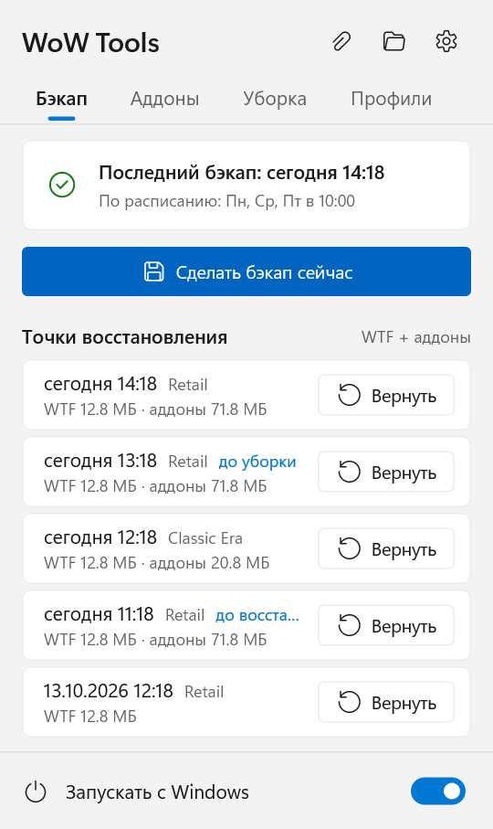
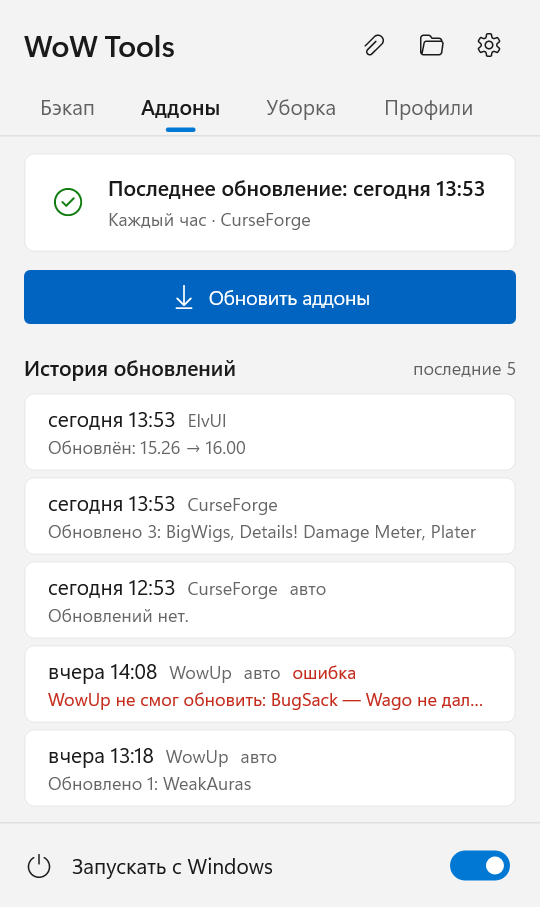
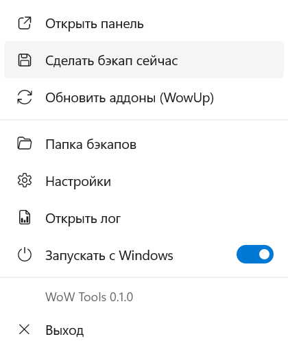
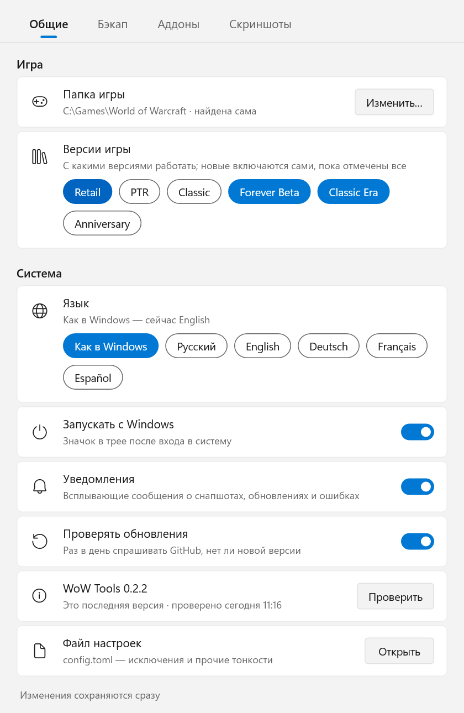
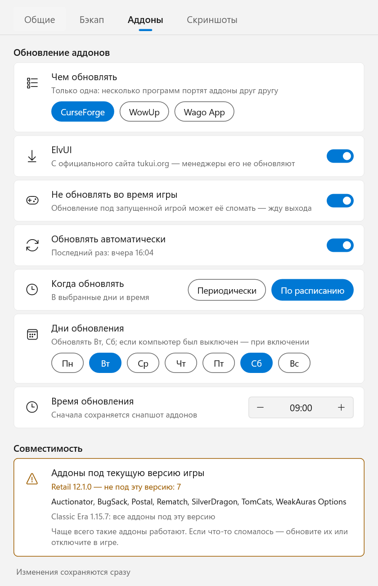
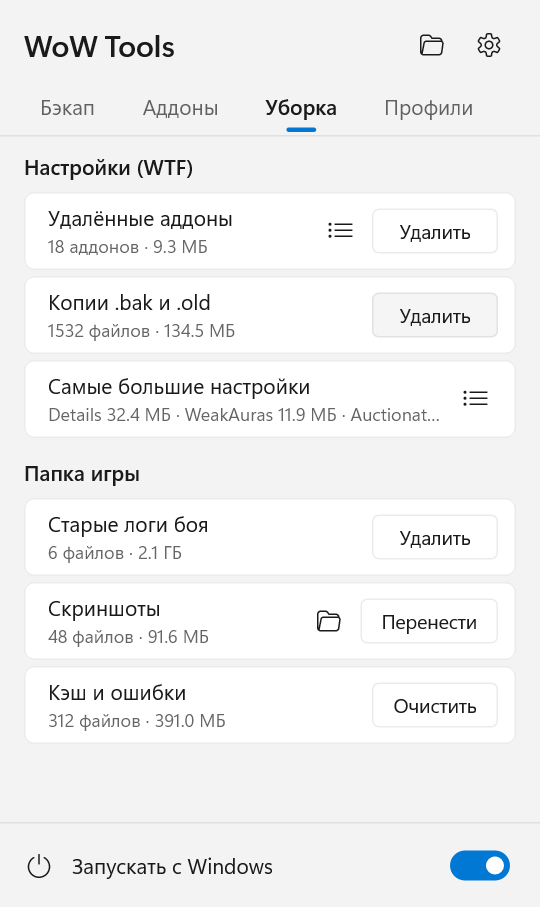
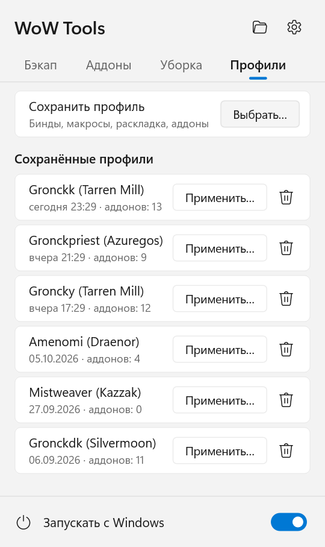

# WoW Tools

[English](README.md) · **Русский** · [Deutsch](README.de.md) · [Français](README.fr.md) · [Español](README.es.md)

Небольшая программа в трее Windows для World of Warcraft, которая бережёт ваши настройки и аддоны:

- **Бэкапы** `WTF` (бинды, макросы, чат, CVars, настройки аддонов) и `Interface\AddOns` — после каждой игровой
  сессии или по расписанию, для всех установленных версий игры.
- **Восстановление в один клик** на любую прошлую точку; текущее состояние сначала сохраняется, так что восстановление
  всегда можно отменить.
- **Копирование настроек между персонажами**: бинды, макросы, окна чата, расположение фреймов, включённые аддоны,
  настройки аддонов.
- **Обновление аддонов** через менеджер, которым вы уже пользуетесь, — CurseForge, WowUp, WowUp-CF или Wago App:
  без окна, по расписанию и никогда во время игры. ElvUI, которого нет ни в одном из них, — прямо с его
  официального сайта.
- **Патчи игры**: когда Battle.net обновляет игру, настройки и аддоны сохраняются до её первого запуска на новой
  версии, и видно, какие аддоны под неё ещё не обновлены.
- **Уборка**: настройки удалённых аддонов, копии `.bak` от WoW, старые логи боя, скриншоты и кэш — с размерами,
  в один клик.
- **Профили интерфейса**: сохраните интерфейс персонажа (бинды, макросы, раскладку, аддоны и их профили) и
  поставьте его другому персонажу в два клика.
- Обновляется сам: раз в день проверяет GitHub и ставит новую версию в один клик.
- Русский, английский, немецкий, французский и испанский языки.

<p>
  
  
  
</p>

## Содержание

- [Требования](#требования)
- [Установка](#установка)
- [Значок в трее и панель](#значок-в-трее-и-панель)
- [Настройки](#настройки)
- [Бэкапы: как это работает](#бэкапы-как-это-работает)
- [Восстановление](#восстановление)
- [Обновление аддонов](#обновление-аддонов)
- [Патчи игры](#патчи-игры)
- [Уборка](#уборка)
- [Профили интерфейса](#профили-интерфейса)
- [Копирование настроек между персонажами](#копирование-настроек-между-персонажами)
- [Командная строка](#командная-строка)
- [Файлы и папки](#файлы-и-папки)
- [Приватность и безопасность](#приватность-и-безопасность)
- [Обновление WoW Tools](#обновление-wow-tools)
- [Удаление](#удаление)
- [Вопросы и ограничения](#вопросы-и-ограничения)
- [Сборка из исходников](#сборка-из-исходников)

## Требования

- **Windows 10 или 11**, 64-бит. Больше ничего ставить не нужно: это один `.exe` без зависимостей.
- **World of Warcraft**, установленный через Battle.net. Поддерживаются все версии игры: Retail, Classic (progression),
  Classic Era / Hardcore / Season of Discovery, Anniversary, PTR, бета и даже версии, которых ещё нет, — всё, что лежит
  в папке вида `_name_` рядом с `_retail_`.
- Только для обновления аддонов — **одна** из этих программ, установленная и настроенная (вход выполнен, папка игры
  выбрана):
  - приложение [CurseForge](https://www.curseforge.com/download/app);
  - [WowUp](https://wowup.io/) или WowUp-CF (сборка с поддержкой CurseForge);
  - [Wago App](https://addons.wago.io/app) — только для WeakAuras и UI-паков, см. [ниже](#wago-app).

  Бэкапы, восстановление и копирование персонажей работают и без них.

## Установка

1. Скачайте `WoW-Tools-x.y.z.exe` из [Releases](https://github.com/Gronck2/wow-tools/releases).
2. Положите его в постоянную папку (например, `%LOCALAPPDATA%\Programs\WoW Tools\`) — автозапуск запоминает этот путь.
3. Запустите. Появится значок в трее; папка игры найдётся сама (реестр, Battle.net, типичные пути).

Windows SmartScreen может предупредить о неизвестном издателе, потому что exe не подписан: нажмите
**Подробнее → Выполнить в любом случае**. В каждом релизе указан SHA-256 файла, так что скачанное можно проверить
(`Get-FileHash .\WoW-Tools-0.1.0.exe`).

Если запустить exe ещё раз, пока программа работает, откроется окно настроек.

## Значок в трее и панель

Значок показывает текущее состояние:

| Значок | Что значит |
| --- | --- |
| серый герб | игра не запущена |
| золотой герб | игра запущена (бэкап будет сделан после выхода из неё) |
| синяя точка | идёт работа: бэкап, восстановление, обновление аддонов, уборка или профиль |
| красная точка | последняя операция не удалась (причина — в подсказке над значком или на панели) |

**Левый клик** открывает панель (в стиле Windows 11, следует светлой/тёмной теме и цвету акцента):

- Вкладка **Бэкап**: когда был последний бэкап и когда они делаются, кнопка **Сделать бэкап сейчас** и последние
  точки восстановления всех версий игры с кнопкой **Вернуть** (подтверждение прямо в строке).
- Вкладка **Аддоны**: когда аддоны обновлялись в последний раз, кнопка **Обновить аддоны** и пять последних
  обновления — что обновилось или что пошло не так (наведите на строку, чтобы увидеть текст целиком).
- Вкладка **Уборка**: что можно прибрать в WTF и в папке игры, с размерами и кнопкой у каждого пункта — см.
  [Уборка](#уборка).
- Вкладка **Профили**: сохранённые профили интерфейса и **Сохранить профиль** — см.
  [Профили интерфейса](#профили-интерфейса).
- Сверху — скрепка, папка бэкапов и настройки, снизу — **Запускать с Windows**. Панель закрывается при клике мимо
  неё; с нажатой скрепкой она остаётся открытой, пока не нажать Esc или не кликнуть по значку в трее.

**Правый клик** открывает меню: панель, бэкап сейчас, обновление аддонов, папка бэкапов, настройки, лог, автозапуск,
выход.

Уведомления приходят о результатах того, что вы запустили сами, и о новых ошибках; выключить их можно переключателем
**Уведомления** в **Настройки → Общие**.

## Настройки

<p>
  
  
</p>

Любое изменение сохраняется сразу и применяется без перезапуска.

- **Общие**: папка игры (находится сама, можно указать вручную), с какими версиями игры работать (бэкапы, уборка, профили), язык, запуск с Windows,
  **Уведомления**, **Проверять обновления** и текущая версия с кнопкой **Проверить** / **Установить**, а также ссылка
  на `config.toml` для редко нужных параметров.
- **Бэкап**: когда бэкапить (*После игры* — когда игра закрывается, или *По расписанию* — в выбранные дни недели
  в заданное время), сколько снапшотов хранить, переключатели **Бэкапить аддоны** и **Ждать выхода из игры**, папка бэкапов.
- **Аддоны**: чем обновлять, **Не обновлять во время игры**, **Обновлять автоматически** и когда —
  *Периодически* (от 30 мин до 12 ч) или *По расписанию* (дни и время); ниже — все аддоны, не рассчитанные на текущую
  версию игры (см. [Патчи игры](#патчи-игры)).
- **Скриншоты**: куда уборка переносит скриншоты и как их раскладывает (см. [Уборка](#уборка)).

## Бэкапы: как это работает

- **Снапшот** — это zip-архив папки: `WTF` и `Interface\AddOns` архивируются отдельно, и для каждой версии игры
  тоже отдельно. Пути внутри архива — относительно папки версии игры.
- Снапшот делается, **только если что-то изменилось**: WoW Tools запоминает отпечаток папки (пути файлов, размеры,
  время изменения) и пропускает неизменившиеся. Аддоны меняются редко, поэтому почти ничего не стоят.
- **Пока версия игры запущена, её снапшоты пропускаются**: WoW записывает `WTF` и настройки аддонов при выходе
  из персонажа или из игры, так что копия, сделанная во время игры, была бы наполовину устаревшей. Остальные версии
  бэкапятся как обычно. В режиме *После игры* бэкап делается через несколько секунд после закрытия клиента.
- **По расписанию**: если в назначенное время компьютер был выключен, бэкап сделается при включении; если была
  запущена игра — сразу после её закрытия. Ручной бэкап засчитывается как плановый.
- **Хранение**: остаются последние `keep` снапшотов (по умолчанию 30) каждой серии, более старые удаляются.
- Файлы `*.bak` и `*.old` не попадают в архив (поэтому `WTF` на 155 МБ обычно умещается в ~13 МБ). Список задаётся
  в `exclude_ext` в `config.toml`.

## Восстановление

**Вернуть** на панели возвращает `WTF` и аддоны этой версии игры к выбранному моменту. Эта версия игры должна
быть закрыта (другие могут работать). Прежде чем что-то заменить, текущее состояние сохраняется снапшотом с пометкой
*до восстановления*, так что вернуться можно всегда.

Архив распаковывается во временную папку рядом с настоящей, и только потом папки меняются местами, так что прерванное
восстановление никогда не оставит наполовину записанный `WTF`.

Снапшоты `AddOns` *до обновления* на панели не показываются: `wow-tools list --kind addons` покажет их,
`wow-tools restore <id> --kind addons` откатит обновление аддонов, не трогая настройки.

Перед уборкой, профилем интерфейса и копированием настроек тоже сохраняется снапшот `WTF` (*до уборки*, *до профиля*,
*до копирования*). Это страховка: на панели из них видны снапшоты *до уборки* и *до профиля*; несколько таких действий за 10 минут
покрывает один снапшот, сделанный перед первым, если игра между ними не меняла `WTF`. `wow-tools list --kind wtf` покажет их, `wow-tools restore <id> --kind wtf`
вернёт.

Из командной строки: `wow-tools restore` (последний), `wow-tools restore 20261012` (последний за этот день или раньше),
`--kind wtf` или `--kind addons` — только одна часть, `--flavor _classic_era_` — другая версия игры.

## Обновление аддонов

WoW Tools сам аддоны не скачивает (кроме [ElvUI](#elvui)). Он запускает уже установленный у вас менеджер аддонов,
даёт ему обновить всё как обычно и закрывает его. Так записи самого менеджера остаются верными, а пожелания авторов,
разрешающих скачивание только через официальные клиенты, соблюдаются.

Используется только **одна** программа: два менеджера, работающие с одной папкой `AddOns`, перезаписывают файлы друг
друга. Если у вас их несколько, выберите одну в **Настройки → Аддоны**; если программа одна, она выбирается сама.

При каждом запуске, автоматическом или ручном:

1. Если включено **Не обновлять во время игры** (по умолчанию включено), пока запущен любой клиент игры, ничего
   не происходит; обновление ждёт, пока игра закроется.
2. Делается снапшот `AddOns` с пометкой *до обновления* — `wow-tools restore <id> --kind addons` отменит обновление.
3. Программа запускается без окна, обновляет аддоны и закрывается. **Если программа уже была открыта, её не
   трогают** — второй раз не запускают и не закрывают.
4. Результат попадает в историю обновлений: какие аддоны обновились, какие всё ещё ждут обновления (например,
   в программе у них ручное обновление) или почему не получилось.

Если в программе выключено автообновление, оно включается только на этот запуск и потом выключается обратно (даже если
запуск прервался — это исправится в следующий раз). Аддоны, которые в программе стоят на ручном обновлении или
игнорируются, не трогаются.

### CurseForge

Запускается с `--minimized` (в свой трей, как при его собственном автозапуске). WoW Tools следит за его логом, пока
проверка обновлений не закончится и минуту ничего не будет устанавливаться (максимум 10 минут), а затем закрывает его.

### WowUp и WowUp-CF

Запускается с `--hidden --quit`: один тихий раунд автообновления, после чего он сам выходит. WowUp обновляет только
аддоны с включённым автообновлением; WoW Tools включает его на этот запуск для всех аддонов, кроме игнорируемых.

> **Аддоны с Wago через WowUp.** Обычный WowUp получает разрешение на скачивание с Wago через рекламу в своём окне.
> Без окна он его не получает, и Wago отказывает в скачивании. Такие аддоны попадают в историю с этой причиной.
> Чтобы их обновить, откройте WowUp, укажите ключ Wago в настройках WowUp или пользуйтесь CurseForge / WowUp-CF, если большинство ваших аддонов оттуда.

### Wago App

В Wago App нет обновления аддонов без участия пользователя — только его кнопка *Update All*, — поэтому, когда выбран
он, обновляются **только WeakAuras и UI-паки**. При его выборе появляются два переключателя: **WeakAuras** и
**UI-паки**. Приложение запускается свёрнутым, пишет обновления в `AddOns\WagoAppCompanion` (WeakAuras, применяются
в игре) и `AddOns\WagoUI_Storage` (UI-паки) и закрывается, когда 15 секунд ничего не пишет. Выключенная часть остаётся
ровно такой, какой была. Если выключено и то и другое, делать нечего и приложение не запускается.

### ElvUI

ElvUI нет ни на CurseForge, ни на Wago, поэтому ни один менеджер аддонов его не обновляет. Когда включён переключатель
**ElvUI** (по умолчанию включён), каждый запуск обновления заодно спрашивает у официального сайта
[tukui.org](https://tukui.org/elvui) текущую версию. Каждая версия игры, где ElvUI установлен и отстаёт, получает новый
архив: папки `ElvUI`, `ElvUI_Libraries` и `ElvUI_Options` заменяются целиком, так что уходят и файлы, оставшиеся от
старой версии (забытый `ElvUI_Mainline.toc` заставил бы игру грузить список файлов старой версии). Установка, в
которой так перемешались версии, переустанавливается, даже если номер версии совпадает. Плагины ElvUI
(`ElvUI_WindTools` и подобные) не трогаются, а версии игры без ElvUI ничего не получают. Это работает и без
установленного менеджера аддонов.

## Патчи игры

Раз в минуту WoW Tools сравнивает версию каждого клиента игры (как её сообщает Battle.net) с последней, которую видел.
Новая версия при закрытой игре значит, что Battle.net только что её пропатчил, а на новой версии игра ещё не
запускалась, — тот самый момент, когда `WTF` и аддоны ещё в состоянии до патча. Тогда WoW Tools:

1. сохраняет `WTF` и `AddOns` снапшотами с пометкой *до патча* (если первый вход после патча что-то сбросит, один клик
   на панели всё вернёт);
2. показывает уведомление с новой версией и аддонами, чей `.toc` не рассчитан на неё (в игре они были бы помечены
   как «устаревшие»).

Какие аддоны не рассчитаны на текущую версию, всегда перечислены полностью внизу **Настройки → Аддоны**
(пока такие есть, карточка жёлтая), а ещё это выводит `wow-tools outdated`. Аддоны оцениваются по мажорной и минорной версии (12.0 → 12.1 считается, хотфикс 12.1.0 → 12.1.5 —
нет); аддон, у которого вообще нет номера версии для этой игры (аддон только для Classic на Retail, библиотека),
не оценивается.

## Уборка

<p></p>

Вкладка **Уборка** на панели показывает, что можно убрать, с числом файлов и их размером, для тех версий игры, которые
вы бэкапите. Список перечитывается каждый раз, когда вы открываете вкладку, и после каждой уборки; наведите на строку,
чтобы узнать, о чём она. Кнопка со списком у *Удалённых аддонов* и *Самых больших настроек* открывает полный список с
размерами прямо поверх вкладки (прокрутка колесом, закрыть — ✕ или Esc).

| Строка | Что | Что происходит |
| --- | --- | --- |
| Удалённые аддоны | `SavedVariables\*.lua` аддонов, которых больше нет в `Interface\AddOns` (собственные файлы Blizzard остаются) | удаляются; сначала `WTF` сохраняется снапшотом *до уборки* |
| Копии .bak и .old | копии, которые WoW делает с каждого файла настроек при выходе | удаляются (WoW создаст их снова; в снапшоты они и так не попадают) |
| Самые большие настройки | файлы настроек от 5 МБ | только показываются: раздутые файлы замедляют загрузку, чистите их в самом аддоне |
| Старые логи боя | `Logs\WoWCombatLog*.txt` | удаляются; логи моложе недели остаются — вдруг их ещё нужно загрузить на Warcraft Logs |
| Скриншоты | `Screenshots\*` | переносятся, по умолчанию в `Pictures\World of Warcraft\<version>\<YYYY-MM>\` (ничего не перезаписывается); значок папки открывает эту папку |
| Кэш и ошибки | `Cache` и `Errors` | удаляются; игра соберёт кэш заново — обычное лекарство от странностей после патча |

Вкладка **Скриншоты** в настройках задаёт, куда их переносить и как раскладывать: папки **По дням**,
**По месяцам**, **По годам** или **Без папок** (дата берётся из имени файла WoW, `WoWScrnShot_MMDDYY_HHMMSS`), и
**Своя папка для каждой версии игры** — вкл. или выкл. Разложить по персонажам нельзя: WoW не записывает, кто сделал
скриншот.

Каждая кнопка сначала спрашивает **Точно?**. Пока идёт уборка, вместо кнопки крутится значок, а итог пишется в строке.
Только кэш запущенной версии игры ждёт, пока её закроют; остальное убирается и во время игры (эти файлы игра
не держит). Из командной строки: `wow-tools clean`
показывает тот же список, `wow-tools clean orphans backups logs screenshots cache` (любые из них) наводит порядок.

## Профили интерфейса

<p></p>

Профиль — это всё, из чего складывается интерфейс персонажа, сохранённое под его именем. На вкладке **Профили**
панели **Сохранить профиль → Выбрать…** показывает ваших персонажей (сверху те, в кого заходили недавно).
**Применить…** у профиля спрашивает, на кого его поставить, потом — **Применить** в строке. Наведите на профиль,
чтобы увидеть, что в нём; корзина его удаляет. Если у персонажа ничего не изменилось с его прошлого профиля,
новый не сохраняется (об этом скажет строка).
В списке персонажей можно сразу печатать — поиск по имени или серверу (Enter выбирает первого, Esc очищает поиск).
Пока версия игры профиля запущена, **Применить…** выключена: при выходе игра перезапишет настройки.

В списках персонажей только те, что сейчас есть на аккаунте: папки удалённых, переименованных и перенесённых
персонажей остаются в `WTF`, поэтому WoW Tools сверяет их со списком персонажей игры (`character-list-order.txt`,
там только GUID) и именами, которые аддоны хранят для этих GUID (BigWigs, WorldQuestTracker, AllTheThings,
RCLootCouncil…). Сервер, где есть персонаж, в которого с тех пор не заходили, не фильтруется: наугад ничего не
прячется.

Что входит в профиль:

- все файлы папки персонажа `WTF\Account\<ACCOUNT>\<Realm>\<Name>`: бинды, макросы, чат, раскладка режима
  редактирования, бинды по клику, включённые аддоны, собственные настройки аддонов персонажа (`SavedVariables`);
- для аддонов, которые хранят настройки общими на аккаунт в виде профилей (ElvUI, BigWigs, Clique, TomTom и другие на
  AceDB): какой профиль у персонажа и содержимое этого профиля.

При применении файлы копируются, а эти аддоны у целевого персонажа переключаются на тот же профиль. На одном аккаунте
персонажи после этого делят его: поменяли ElvUI на одном — поменялось и на другом, как с общим профилем в игре. На
другом аккаунте профиль добавляется; если там уже есть другой профиль с таким именем, копия получает имя исходного
персонажа, так что на том аккаунте ничего не меняется. Аддон, который на целевом аккаунте ни разу не запускался,
не трогается и называется в итоге. Версия игры профиля должна быть закрыта; сначала сохраняется снапшот WTF
*до профиля* (см. [Восстановление](#восстановление)).

Бинды и макросы могут храниться на серверах Blizzard (см. конец следующего раздела).

Из командной строки: `wow-tools profile save "Tarren Mill/Gronckk"`, `wow-tools profile list`,
`wow-tools profile apply 1 --to "Tarren Mill/Groncky"`, `wow-tools profile delete 1`.

## Копирование настроек между персонажами

Персонажи лежат в `WTF\Account\<ACCOUNT>\<Realm>\<Name>`. Чтобы скопировать настройки одного персонажа на других:

```
wow-tools chars
wow-tools copy-char --from "Tarren Mill/Groncky" --to "Kazzak/Groncky" --dry-run
wow-tools copy-char --from "Tarren Mill/Groncky" --to "Kazzak/Groncky" --to "Silvermoon/Gronckowski" --parts bindings,macros,savedvars
```

| Часть | Что | Файл |
| --- | --- | --- |
| `bindings` | бинды клавиш | `bindings-cache.wtf` |
| `macros` | макросы персонажа | `macros-cache.txt` |
| `chat` | окна и каналы чата | `chat-cache.txt` |
| `config` | CVars персонажа | `config-cache.wtf` |
| `layout` | расположение фреймов | `layout-local.txt` |
| `addons` | какие аддоны включены | `AddOns.txt` |
| `savedvars` | настройки аддонов персонажа | `SavedVariables\*.lua` |

Без `--parts` копируется всё. Регистр в именах не важен (в кириллице тоже); если имя есть на нескольких аккаунтах,
пишите `ACCOUNT/Realm/Name`. Сначала `WTF` сохраняется снапшотом *до копирования*; версия игры должна быть закрыта.

Бинды и макросы могут храниться на серверах Blizzard (CVars `synchronizeBindings` / `synchronizeMacros`) — тогда
серверная копия может перезаписать скопированные файлы при входе в игру.

## Командная строка

`wow-tools` без команды запускает трей. Всё остальное доступно и из консоли:

| Команда | Что делает |
| --- | --- |
| `init [--wow-path DIR] [--backup-dir DIR]` | создать конфиг (папка игры находится сама) |
| `status` | найденная установка, версии игры, настройки, программы для аддонов и ожидающие обновления |
| `backup [--flavor F] [--kind wtf\|addons] [--force]` | сделать снапшот (только того, что изменилось, если нет `--force`) |
| `list [--flavor F] [--kind K]` | список снапшотов |
| `restore [ID\|DATE\|latest] [--kind K] [--flavor F] [-y]` | восстановить, сначала сохранив текущее состояние |
| `chars [--flavor F]` | список персонажей |
| `copy-char --from C --to C [--to C…] [--parts …] [--dry-run]` | скопировать настройки между персонажами |
| `profile save C [--flavor F]` / `profile list` | сохранить профиль интерфейса персонажа / список профилей |
| `profile apply N --to C` / `profile delete N` | поставить профиль N (из списка) на персонажа / удалить его |
| `update-addons` | обновить аддоны сейчас через выбранную программу |
| `watch [--interval N]` | то же, что делает трей, но в окне консоли |
| `schedule logon [--headless]` | запускать трей при входе в Windows (`--headless`: `watch` без значка) |
| `schedule interval [--every MIN]` | задача Планировщика, запускающая `backup` каждые N минут (по умолчанию раз в сутки) |
| `schedule status` / `schedule remove` | показать / убрать автозапуск и задачу |
| `outdated` | аддоны, не рассчитанные на установленную версию игры |
| `clean [orphans\|backups\|logs\|screenshots\|cache …]` | показать, что можно убрать; с пунктами — убрать их |
| `self-update [--check]` | проверить на GitHub, нет ли новой версии WoW Tools, и установить её |

Общие параметры: `--config FILE` (другой конфиг), `--log-to-file`, `-v`. `wow-tools <command> --help` расскажет
остальное на выбранном языке.

## Файлы и папки

| Путь | Что |
| --- | --- |
| `%APPDATA%\WoW Tools\config\config.toml` | настройки |
| `%LOCALAPPDATA%\WoW Tools\data\backups\<version>\wtf\*.zip`, `...\addons\*.zip` | снапшоты (папку можно сменить) |
| `%LOCALAPPDATA%\WoW Tools\data\backups\profiles\<version>\*.zip` | профили интерфейса (в папке бэкапов) |
| `%LOCALAPPDATA%\WoW Tools\data\wow-tools.log` | лог трея |
| `%LOCALAPPDATA%\WoW Tools\data\addon-updates.json` | история обновлений (последние 20) |
| `%LOCALAPPDATA%\WoW Tools\data\self-update.json` | когда WoW Tools последний раз проверял новую версию |
| `%LOCALAPPDATA%\WoW Tools\data\game-versions.json` | последние замеченные версии игры, чтобы заметить патч |

Снапшоты называются `YYYYmmdd-HHMMSS[-label].zip`; это обычные zip-файлы, их можно открыть вручную.

В `config.toml` есть и то, чего нет в окне: `exclude_ext` (исключаемые расширения, по умолчанию `["bak", "old"]`)
и `language` (`ru`, `en`, `de`, `fr`, `es`; если не задан — язык интерфейса Windows).

## Приватность и безопасность

- Сам WoW Tools подключается к двум местам. К **GitHub** — чтобы узнать, нет ли новой версии WoW Tools (см.
  [Обновление WoW Tools](#обновление-wow-tools)), раз в день, и это можно выключить. И к **tukui.org** — во время
  обновления аддонов, если ElvUI установлен и его переключатель включён, за [ElvUI](#elvui). Оба — обычные запросы
  последней версии, как если открыть страницу загрузки в браузере; никаких сведений о вас, вашей игре или аддонах не
  передаётся.
- Аддоны скачивает только выбранная вами программа для аддонов — кроме ElvUI, который WoW Tools берёт с его
  официального сайта.
- Он никогда не трогает саму игру, не читает её память и ничего не автоматизирует в игре.
- В папку игры он пишет, только когда вы восстанавливаете бэкап, копируете настройки персонажа, наводите порядок
  или программа для аддонов обновляет аддоны, — и перед всем, что затрагивает настройки или аддоны, делается снапшот.

## Обновление WoW Tools

WoW Tools раз в день заглядывает в [релизы](https://github.com/Gronck2/wow-tools/releases) этого репозитория (а ещё
когда вы нажимаете **Проверить** в **Настройки → Общие**). Если вышла новая версия:

- один раз появляется уведомление;
- на панели рядом со значками папки и настроек появляется кнопка с номером новой версии;
- в меню появляется **Обновить до x.y.z**, а в настройках — **Установить**.

Один клик — и новый exe скачивается, сверяется с контрольной суммой SHA-256, которую GitHub публикует для файла
релиза (несовпавший файл никогда не устанавливается), встаёт на место текущего, и трей перезапускается. Старый exe
остаётся как `<name>.exe.old` до следующего запуска, потом удаляется. Если идёт бэкап или обновление, перезапуск
дождётся его окончания. Настройки, снапшоты и автозапуск остаются как были.

Из командной строки: `wow-tools self-update --check` (только проверить) или `wow-tools self-update` (проверить
и установить; после этого перезапустите трей). Чтобы не проверять обновления, выключите **Проверять обновления**
в **Настройки → Общие** (`check_updates = false` в `config.toml`).

## Удаление

1. Выключите **Запускать с Windows** (или выполните `wow-tools schedule remove` — это заодно удалит задачу
   Планировщика).
2. Выберите **Выход** в меню трея.
3. Удалите exe и, если настройки и снапшоты не нужны, папки `%APPDATA%\WoW Tools` и `%LOCALAPPDATA%\WoW Tools`.

## Вопросы и ограничения

- **Восстановление пишет, что игра запущена.** Закройте эту версию игры (лаунчер Battle.net можно не закрывать).
- **Скопированные бинды пропали после входа.** Они синхронизируются с сервером; см.
  [выше](#копирование-настроек-между-персонажами).
- **Обновление пишет «обновлений нет», а программа показывает обновления.** Эти аддоны в программе стоят на ручном
  обновлении или игнорируются, либо (в WowUp) они с Wago — причина указана в строке истории.
- **Можно ли использовать несколько программ для аддонов сразу?** Нет, и это намеренно: они ломают аддоны друг другу.
- **Где ищется папка игры?** В реестре, в списке установок Battle.net, затем по обычным путям
  (`C:\Program Files (x86)\World of Warcraft`, `X:\Games\World of Warcraft`, …). Версии игры, которые Battle.net
  установил в другие папки, тоже находятся. Если не нашлась — укажите её в **Настройки → Общие**.

## Сборка из исходников

```
cargo build --release
```

Rust stable, Windows. CI (GitHub Actions) при каждом push проверяет форматирование, clippy, тесты и сборку; тег
`vX.Y.Z`, совпадающий с версией в `Cargo.toml`, собирает exe и создаёт черновик релиза. Тексты лежат
в `locales/<language>.toml`.
